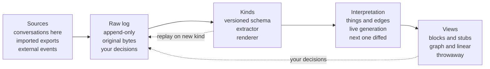
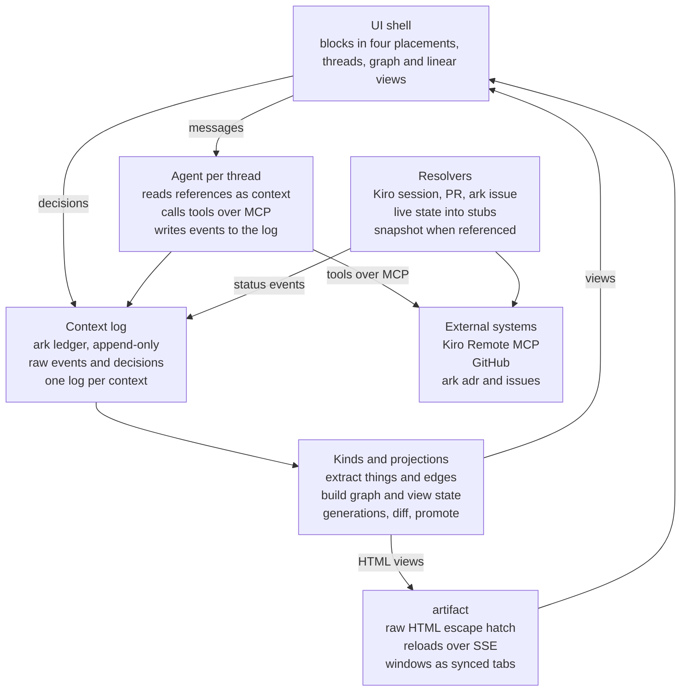
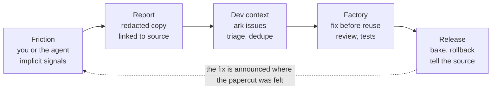

# draft design

Nov 20, 2026 · Niko Virtala

## Context and problem

Everything should fold around the conversation, threads and references: you ask and describe, the agent delivers. The UI builds itself as the work goes, the same way agent harnesses build the tools they need.

The problem it solves is switching between tools. Every tool is another mental model to hold, and holding several at once is cognitively expensive. Kiro Crew adds to that, with something going on everywhere at once.

One mental model that keeps getting better beats many models held side by side. So the grammar of the UI stays small and fixed, and only the content is generated.

## Name

The tool is called **draft**. The name has to work in speech, so it carries several meanings at once:

- **A first version.** Nothing in the tool is final. Views are recomputed, history is refolded, and the map keeps changing, so it's always a draft. The point is the journey, not the destination.
- **A drawing.** A draftsman draws plans and maps.
- **A ship's draft.** It sails alongside ark.
- **Drafting someone into the work,** the way a thread brings in an agent or a Kiro session.

In packages it's `@nikovirtala/draft`. Drafts, a long-running iOS and Mac app for capturing text, is a near collision to keep in mind if this ever becomes a public app.

## Goals and non-goals

The prototype has to prove that one conversation can replace the tool hopping. The non-goals below are proposed boundaries for the first version.

Goals:

- One mental model: a small, fixed grammar whose content is generated.
- No permanent chrome. Controls appear in context and go away when they're used.
- Supervise many agent sessions from one conversation, without opening other tools.
- Everything can be addressed and referenced, and the references form a graph.
- Outside data can be imported, and all history can be reprocessed when new kinds of things are introduced.

Non-goals for the first version:

- A general chat app, or a replacement for Kiro or Claude.
- Free-form generated layouts. The agent fills blocks; it doesn't invent new layout.
- Real-time editing by several people at once.
- Phone layouts.

## Core model: blocks and placements

There is one primitive, the block, and it can live in four places. Everything visible is a block: an artifact, a live status, a thread, the graph view.

| Placement | What it shows | Its controls |
| --- | --- | --- |
| Inline | The block where it was created, as a preview | Minimize, open in panel, pop out |
| Minimized | One line: title and live status | Expand, open in panel, pop out |
| Panel | The full block on the right. A thread continues the conversation there | Pop out, close |
| Window | The full block in its own window, titled with where it came from | Close |

Rules:

- Moving a block never changes its content. Placement is view state, kept apart from the log.
- A moved block leaves a stub where it was created, showing where it went.
- Only one level uses the panel. Anything deeper uses windows.
- The agent may suggest a move but never makes one. Your layout changes only when you change it.
- The icons on each block are the only buttons. Everything else is conversation.
- Placement is kept per device, so a phone can turn "panel" into a full-screen push.

## Threads

A thread is a block whose content is a conversation. It branches off any message and continues in the panel, while the main conversation stays on the left.

- The main conversation keeps a thread stub where the thread branched off. It shows live state: "2 new", "waiting on you", "1 artifact".
- When a thread wraps up, its conclusion returns to the main conversation as a summary, so decisions don't disappear into threads.
- Blocks made inside a thread follow the same rules but can't take the panel, because the thread holds it. They go inline, minimized or into a window.
- A window popped out of a thread names the thread it came from, and the thread keeps a stub.
- Interrupts are messages. Permission requests, merge conflicts and reviewer verdicts arrive in the thread they belong to, in one attention order across all threads.

Rejected alternative: opening a thread's artifact in the panel and pushing the thread out to a window. It's more flexible, but layouts would start rearranging themselves.

## Built-in browser

An external link opens as a web page block inside the tool, so following a link never takes you away from the conversation. A web page is just another kind of block and follows the same placement rules.

- **Placements as usual.** Inline, a link shows as a preview card. Opened, it goes to the panel, or to a window when a thread already holds the panel. Minimized, it's a one-line stub with the page title.
- **One browser per thread.** Links opened from the same conversation or thread reuse its browser block, with back and forward, instead of spawning a new window for each link. Popping one out gives a second browser on purpose.
- **Resolvers come first.** A link to something with a resolver (a PR, a Kiro session, an ark issue) opens as its live block, not as a web page. The browser is the fallback for everything else, and each resolved block can still open its page.
- **Pages are referenceable.** A reference to a page keeps a snapshot (URL, title, time and content hash), so "the page I read yesterday" still makes sense after the page changes.
- **Web content is untrusted.** The agent reads a page only when you reference it or ask about it, and page text is marked as untrusted input. This is the same trust rule as crossing a context boundary.
- **Visits are raw events, if you allow it.** Then a later kind can find, for example, everything you read while working on a decision. Recording is a per-context setting.
- **Sign-ins live per context.** A work context and a personal context don't share cookies.

The browser settles part of the platform question. Many sites refuse to load inside an iframe, so a real browser needs a desktop shell with a native web view. A web-only prototype can show a server-fetched reader view for public pages, but not signed-in apps.

## References and the graph

Anything can be referenced: messages, threads, artifacts, versions and live statuses. The references form a graph that nobody draws, because it's computed from the log.

Every item has a stable address that includes its context from day one, such as `context/conversation/item@version`. Linking contexts later then needs no migration.

| Edge kind | Comes from | Examples | On reprocessing |
| --- | --- | --- | --- |
| Structural | The log itself | forked, produced, supersedes | Kept |
| Explicit | Your @-mentions and the suggestions you accept | mentions, cites | Kept |
| Suggested | The agent's inference, shown as a suggestion until accepted | about | Regenerated |

Versions and snapshots:

- A reference points at a version. "Design doc v1" still means v1 after v2 exists, so old messages never change meaning.
- A reference to a live status keeps the state it had when mentioned ("green when you asked") next to its current state.

Views of the graph are blocks too, so they follow the placement rules:

- **Graph** shows the shape of things. By default it shows the neighbourhood of the focused item, not the whole tangle.
- **Linear** shows the log in order, with references as arcs and thread items indented. The arcs may later live in the conversation's own left margin.
- **Backlinks** on every block list what references it and what it references.

References also choose the agent's context. "Does @ADR 0007 change @Design doc?" tells the agent exactly what to load, plus what those two link to. This overlaps with the `context` tool planned for ark.

## Contexts and the universe

A context is a bounded knowledge graph: personal, shared with a team, or tied to a project. Contexts can reference each other, but they don't have to.

- **A context owns its log.** Each item lives in exactly one context and can be referenced from anywhere. Nothing to sync, nothing to merge.
- **The universe has no structure of its own.** It's whatever you can reach by following references between contexts, like the web.
- **A reference across contexts keeps a snapshot** of title, version and hash. When the target is unavailable, the reference stays readable instead of breaking.
- **The context boundary is a trust boundary.** By default the agent sees only the current context, and crossing into another needs an explicit reference. Text from another context gets in only when you pull it in, which limits prompt injection.
- **Sharing happens at the boundary**, not item by item. A personal context can reference a team context without exposing itself.
- **Creating a context** starts out explicit ("new context for X") or derived from something that exists, such as a repo or a project. Contexts suggested by the agent come later.

## Knowledge pipeline

Raw data lasts forever, your decisions are facts, machine interpretation can always be redone, and views are throwaway. This one rule lets old, imported and native contexts all benefit from things introduced later.

A new kind replays the raw log. Your decisions, made in the views, are written back as raw events.

The three layers:

- **Raw** is append-only and immutable, stored as the original bytes. Conversations in this tool are raw data too, so importing is just adding another source.
- **Interpretation** is the things and edges that kinds extract. Each one records its provenance: the raw span, the kind version and the model.
- **Views** are computed from the interpretation layer and can be thrown away.

A kind is a small plugin: a versioned schema, an extractor and a renderer (how it looks as a block, stub and node). Adding a kind means registering it and replaying the raw log through it, for every context.

Rules:

- Store raw data unnormalized. Normalizing is a versioned step in the interpretation layer, so a future kind can still find what normalizing would have dropped.
- Your decisions (mentions, accepted edges, corrections) are raw events. Reprocessing never overwrites them.
- IDs must survive reprocessing, either derived from the source or matched to existing items. This is the hardest problem, so it gets prototyped first.
- Reprocessing produces a new generation of interpretations. It's diffed against the live one before it's promoted: blue/green for knowledge.
- Reprocess lazily, when a context is opened, within a configurable budget.
- A new kind version must still read what older versions produced.

## Architecture sketch

Everything goes through one append-only log per context, and everything on screen is computed from it. Most of the parts already exist in some form in ark, artifact and kiro-remote.

- **UI shell** renders blocks from view state. Placement is stored per device, apart from the log.
- **Agent per thread** gets the referenced items and their neighbours as context, calls tools over MCP, and writes what it does back to the log.
- **Context log** is the raw layer. The ark ledger is the first candidate, since it's already git-backed, event-sourced and backward compatible.
- **Kinds and projections** extract things and edges, build the graph and view state, and run reprocessing generations.
- **Resolvers** turn references to outside things (Kiro sessions, PRs, ark issues) into live stubs, and take a snapshot whenever one is referenced.
- **artifact** is the escape hatch for raw HTML views, with reload over SSE. In the prototype its synced tabs stand in for real windows.

The agent describes a view using a fixed set of components (a JSON description), not raw HTML. That keeps the grammar stable, makes views safe to render, and lets them update live from references. Raw HTML through artifact is only for what the components can't express.

## Built-in feedback loop

The tool improves itself the same way ark does: friction gets reported where it happens, and a papercut is fixed before the next session runs into it. Its own development is a context inside the tool, so the loop runs on the tool's own grammar.

When a release fixes a papercut, the message is posted in the conversation where it was reported, as a reference to that spot.

Where reports come from:

- **You**, in plain conversation ("this is annoying"). No separate feedback button: a friction kind picks it up.
- **The agent**, instructed to report its own papercuts: a failing tool, a missing kind, a reference it couldn't resolve. Same practice as ark's agents.
- **Implicit signals** that nobody has to report:
  - views that fall back to raw HTML, which means the component set is missing something
  - placements you undo right away
  - extractions you keep correcting
  - resolver errors
  - threads that stall

How it fits the rest of the design:

- **Friction is a kind.** Introducing it replays the whole history, so papercuts felt before the kind existed get found too.
- **Reports cross a context boundary**, so a report is a redacted snapshot with a reference back to where it came from. Nothing else from that context leaks out.
- **Reports are untrusted input.** They can carry prompt injection, so they go through the same triage and promotion gate as in ark, and dramatic changes still come to you.
- **The development context uses ark directly:** issues for papercuts, adr for decisions, and the software factory for fixes, with bake time and rollback on release.
- **New kinds and components come from the same loop.** Repeated raw-HTML fallbacks suggest a component; repeated corrections suggest a better kind version.

Open question: what counts as a papercut automatically, and what needs your confirmation first?

## Non-functional requirements: observability and audit

The implementation must be fully observable (usage and diagnostics) and auditable. Most of the audit comes from the design itself, because every change is already an event in an append-only log. Observability has to be built in from the first commit.

### Audit

- **The context log is the audit trail.** Messages, decisions, agent actions, tool calls, permission answers, page reads, reprocessing runs and promotions are all events in it. Nothing changes state outside the log.
- **Every event has an actor:** you, the agent of a given thread (with model and version), a kind (with version), a resolver, or the factory. The agent never acts under your identity.
- **Every agent action records its grounds:** the references it loaded as context, the tools it called and their results. "Why did it do that?" is answered from the log, not by guessing.
- **Cross-boundary access is recorded:** each read across contexts, each web page read, each report sent to the development context.
- **The log is tamper-evident.** Events are hash-chained, which the git-backed ledger gives for free, so a rewritten history shows.
- **Interpretations are auditable too.** Every extracted item names its raw source, kind version and model, and every generation promotion records what changed and who approved it.

### Observability

- **One trace per turn.** A trace ID follows a message from the UI through the agent, model calls, MCP tools (Kiro Remote, GitHub, ark), resolvers and kinds. The same ID is stamped on the log events the turn produced, so diagnostics and audit join up.
- **OpenTelemetry for traces, metrics and logs,** exported to whatever backend is at hand. Locally a collector is enough; on AWS the usual managed services.
- **Usage is measured:** placements, references, threads, kinds in use, feedback signals. These metrics also feed the built-in feedback loop.
- **Cost is measured:** tokens and model time per turn, thread, context and reprocessing generation, checked against the configured budgets.
- **Health is measured:** latency per step, resolver freshness, failed and retried tool calls, raw-HTML fallbacks, reprocessing backlog.
- **Telemetry carries IDs and numbers, never content.** Message text, artifacts and page contents stay in their context's log, so observability never becomes a way around the context boundary.

## Technology choices

The first live prototype is a local, single-user desktop app in TypeScript, built mostly from parts that already exist. Versions are the latest major releases as of 20 November 2026.

| Layer | Choice | Version | Why |
| --- | --- | --- | --- |
| Runtime for tooling | Node.js | 26 LTS | The current LTS line. The app itself runs on the Node that Electron bundles. |
| Language | [TypeScript](https://devblogs.microsoft.com/typescript/announcing-typescript-7-0/) | 7.0 | The native Go compiler: 8 to 12 times faster builds. |
| Package and tool versions | pnpm, mise | current | The existing setup. |
| Desktop shell | [Electron](https://releases.electronjs.org/) | 45 | Real windows and native web views for the built-in browser, TypeScript all the way down. |
| Build | electron-vite with [Vite](https://vite.dev/blog/announcing-vite8-1) | 5 with 8.1 | Check that electron-vite supports Vite 8 when scaffolding; if not, use Vite 7 until it does. |
| UI | [React](https://react.dev/blog/2026/09/09/react-19-3) | 19.3 | Renders the fixed component set from view descriptions. |
| Schemas | Zod | 4 | View descriptions, events and tool inputs. It's also the Agent SDK's peer dependency. |
| Agent | [Claude Agent SDK](https://code.claude.com/docs/en/agent-sdk/overview), TypeScript | 0.3.x (pre-1.0) | Agent loop, MCP client, sessions, hooks and skills. One session per thread, Opus 5.5 by default. |
| The tool's own MCP server | MCP TypeScript SDK | 1.x | Exposes contexts to other agents and to Claude. |
| Tools for the agent | Kiro Remote, ark and GitHub MCP servers | current | Interrupts come from Kiro Remote permission and PR events. |
| Raw log | ark ledger | current | Append-only and hash-chained. Writes are batched, because git is slow per event. |
| Views and graph index | SQLite through [node:sqlite](https://nodejs.org/docs/latest/api/sqlite.html) | built in (release candidate) | No native module to rebuild for Electron. Fall back to better-sqlite3 if Electron's Node lacks it. |
| Telemetry | [OpenTelemetry JS SDK](https://opentelemetry.io/blog/2026/otel-js-sdk-3-0/) | 3.0 | Traces, metrics and logs are all stable in JavaScript. A local collector for now. |
| Raw HTML views | artifact | v1 | The escape hatch, with reload over SSE. |

Left out of the first prototype: more than one context (addresses are still context-qualified), imports, kinds and reprocessing, AWS deployment and sign-in.

Native Swift stays the candidate for version 2, once the grammar has settled. Tauri was passed over because it adds Rust and embedding external sites inside a panel is still rough there.

## Bringing Claude in

The agent inside the tool is Claude, through the Agent SDK, with a Claude Console API key. Anthropic's docs say apps built on the Agent SDK must not offer claude.ai sign-in unless Anthropic has approved it, so the API key is the way ([Agent SDK overview](https://code.claude.com/docs/en/agent-sdk/overview)).

What carries over by itself: the Agent SDK loads skills, memory files and plugins from `~/.claude` and from the project's `.claude` folder, the same way Claude Code does. The skills in `nikovirtala/skills` work in the tool as they are.

What doesn't carry over: claude.ai memory, past chats, artifacts and claude.ai connectors. They live in claude.ai and can't be reached through the API. Three bridges cover the gap:

- **The tool as an MCP server for Claude.** It exposes contexts as tools: read, search, reference, append. Locally it's added to the Claude desktop app. Later it runs on AWS with OAuth 2.1, like Kiro Remote, as a custom connector, so Claude on any device works in the same contexts.
- **Claude's history as a source.** The claude.ai data export is imported into a context as raw data, and a conversation kind turns past chats into threads and references. This is the import pipeline doing its normal job.
- **Shared tools.** Your own MCP servers (Kiro Remote, ark, Longplay) connect to both the tool and claude.ai, so both see the same sessions, issues and decisions.

Going forward, the context graph replaces memory inside the tool, with better guarantees: everything has a source, a version and an actor.

## Prototype plan

The first job to test: supervising the software factory's Kiro sessions from one conversation, without opening Kiro, GitHub or anything else. It has real stakes, clear interrupts and daily use, so it shows quickly whether the mental load actually drops.

1. **Diary week.** Use Claude with the Kiro Remote MCP and artifacts as a rough version of the tool. Write down every moment you have to leave, or lose track. That list becomes the spec, and the first run of the feedback loop.
2. **Identity spike.** Moved to just before the first kind. Without machine extraction, IDs are assigned when items are created and never change, so the first prototype doesn't need it.
3. **Log, context and references.** One context with context-qualified addresses, an actor and a trace ID on every event, plus resolvers that render Kiro sessions, PRs, ark issues and artifacts as live stubs.
4. **Blocks and placements.** Inline, minimized, panel and window, with threads in the panel. A browser tab synced over SSE stands in for real windows.
5. **Interrupts and attention.** Kiro Remote permission requests and PR events routed into the right threads, in one attention order.
6. **Graph, linear view, import.** Then the first new kind, with a replay over the existing history.

Each step is usable on its own, and the diary week may reorder the rest.

## Open questions

- [ ] The prototype runs on Electron. Does version 2 move to a native shell, close to Two Voices, once the grammar has settled?
- [ ] Can the ark ledger hold both the conversation log and the interpretation events?
- [ ] How do extracted items get stable IDs: derived from the source, or a matching step after extraction?
- [ ] What's the cost budget for reprocessing, and does it run only when a context is opened?
- [ ] What closes a thread: you, the agent, or an outcome such as a merged PR?
- [ ] Do arcs in the margin replace the linear view, or sit beside it?
- [ ] How does this relate to Two Voices and the ark wiki: the same core with separate products, or one product?
- [ ] ark plans a member called `context`, while this design uses "context" for the bounded knowledge graph. Which one gets another word?
