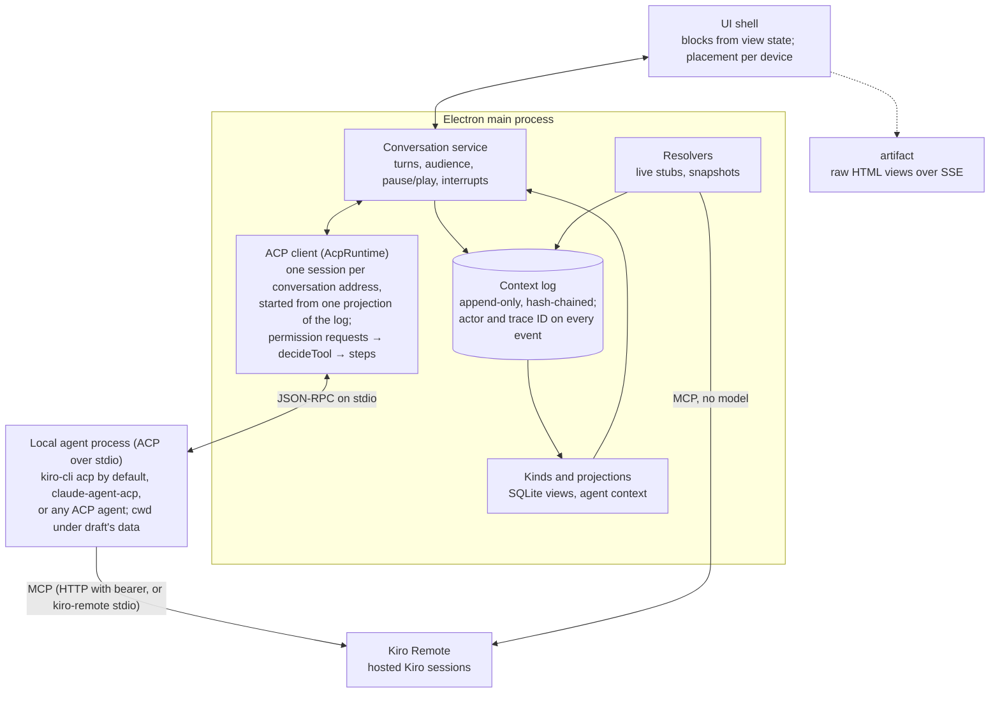
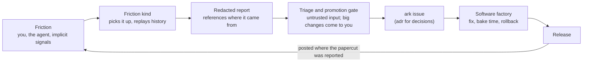

# draft: implementation

How draft is built right now. The model it implements, which stays true however it is built, is in [model.md](model.md). Technology choices will move into ADRs over time; this file summarises and links them.

## Agents over ACP

draft is an ACP client. It speaks the Agent Client Protocol (protocol version 1, through `@agentclientprotocol/sdk` 2.x) to whatever agent runs a conversation, so the agent is configuration, not code. Built in slice 2: `AcpRuntime` in `apps/desktop/src/main/acp/`.

- **Local Kiro is the default.** draft starts `kiro-cli acp --agent-engine=v3 --auth-method=cli`, and Kiro keeps its own sign-in, models and MCP servers, so draft never handles a credential ([Kiro: migrate an ACP client to CLI V3](https://kiro.dev/docs/cli/v3/acp-migration/)).
- **Claude runs through `claude-agent-acp`,** the ACP adapter for the Claude Agent SDK, with a Claude Console API key that the adapter reads from `ANTHROPIC_API_KEY` in the environment draft starts from ([claude-agent-acp](https://github.com/agentclientprotocol/claude-agent-acp)). draft stores no agent credential.
- **Any other ACP agent works** without changes to draft: `agent` and `agents` in `config.json`.
- **Sessions are keyed by conversation address,** so each thread can be its own ACP session, even on different agents. Every session starts from one projection of the log, never the agent's own memory (ADR h89hcrk6).
- **Every agent is made to ask.** draft switches Kiro's autopilot off and Claude's mode to `default`, without Claude's user settings or built-in tools, and won't start a session the agent won't take that on. Permission requests go through `decideTool`, so an approved call that changes something is a durable step before the agent proceeds. A call that runs without asking is logged as `agent.anomaly` and shown as an interrupt (ADR 06wp7907).
- **The agent runs in its own directory** under draft's data, with no `fs` or `terminal` capability: its only tools are Kiro Remote's, handed over in `session/new` over HTTP with a bearer header (or the `kiro-remote` stdio client when the agent has no HTTP MCP).
- **ACP updates stream into the conversation.** The log's actor names the agent and the model it reports. Usage is what the agent reports (token counts, Kiro's credits, context fill); a turn that reports nothing says so in its span.
- **draft builds on standard ACP.** Agent-specific extensions, such as Kiro's `_kiro/...` methods, are used only when the agent advertises them, so draft never turns into a single-agent client.

Two connections, kept apart:

| Connection | What it's for | How |
| --- | --- | --- |
| draft's own agent | The conversation: answers, actions, artifacts | ACP over stdio, to a local agent process |
| Hosted coding agents | Kiro cloud sessions that draft supervises | Kiro Remote: live stubs and interrupts from draft's resolver, and Kiro Remote as an MCP server for the local agent, so it can launch and steer sessions |

## Architecture sketch

Everything goes through one append-only log per context, and everything on screen is computed from it. It has two outward connections, kept apart: ACP to its own agent, and Kiro Remote to the hosted coding agents it supervises.



- **UI shell** renders blocks from view state. Placement and focus are stored per device, apart from the log.
- **ACP client** keeps one ACP session per conversation address (per thread, once threads exist), starts each from the log's projection, streams the agent's updates into the conversation, turns its permission requests into prompts and steps, and writes everything to the log.
- **Local agent** is a separate process speaking ACP over stdio: `kiro-cli acp` by default, `claude-agent-acp` or any other ACP agent by configuration. It reaches its tools over MCP, Kiro Remote included.
- **Context log** is the raw layer: append-only and hash-chained, with an actor and a trace ID on every event. Slice 1 built draft's own log; the ark ledger was measured fast enough and stays an option. A torn last line is moved to a sidecar and recorded (ADR 4gwyn86q).
- **Kinds and projections** extract things and edges, build the graph and view state, and run reprocessing generations.
- **Resolvers** turn references to outside things (hosted Kiro sessions, PRs, ark issues) into live stubs, talking to Kiro Remote directly with no model involved, and take a snapshot whenever one is referenced.
- **artifact** is the escape hatch for raw HTML views, with reload over SSE. In the prototype its synced tabs stand in for real windows.

The agent describes a view using a fixed set of components (a JSON description), not raw HTML. That keeps the grammar stable, makes views safe to render, and lets them update live from references. Raw HTML through artifact is only for what the components can't express.

## Data model

JSON inside, markdown at the edges. Everything draft derives is stored as polymorphic JSON. Markdown is a rendering: an export, a view, the agent's working format, and ark's format in git. It is never the stored data.

Why:

- **Stable identity.** References, comments, snapshots and edges point into documents. Markdown has no stable IDs, so a reference into a paragraph breaks when the text moves. A JSON document tree gives every node an ID that survives edits.
- **Kinds need typed fields.** State machine guards check fields, not prose.
- **Structural diffs.** Generation diffs, revert and audit need "this node changed", not a line diff.

### The envelope

Every item has the same envelope, and its kind carries the body. Items are a Zod discriminated union on `kind`, built from the kind registry, so a new kind brings its own schema.

```json
{
  "id": "…",
  "kind": "assumption",
  "kindVersion": 2,
  "context": "ark",
  "actor": "kiro-local",
  "trace": "1b64…",
  "state": "load-bearing",
  "body": {
    "statement": ["document nodes, each with an id"],
    "evidence": []
  }
}
```

Rich text inside a body is a document tree: paragraphs, headings, lists, and references as inline nodes, each with its own ID.

### Rules

- **Raw stays raw.** An imported file keeps its original bytes, markdown included, because reprocessing with a new kind needs the original. Everything derived from it is JSON.
- **ark records stay markdown in git.** PR diffs, GitHub and agents read markdown well, and git is the source of truth for records. draft keeps a JSON mirror and writes markdown out deterministically; an edit made in git comes back through import, parsed into nodes and diffed. Identity across that round trip is the identity spike in the prototype plan.
- **The agent works in markdown.** It sees a markdown projection with references as tokens and writes markdown back, which draft parses into nodes. The model gets the format it handles best; the store keeps the structure.
- **Versioned bodies.** Every body carries `kindVersion`. Old versions are upcast on read; the log is never rewritten.
- **Canonical JSON for the hash chain.** Events are canonicalized (RFC 8785, JCS) before hashing, so key order can never break the chain.
- **Unknown kinds are kept.** An item whose kind this build doesn't know is stored intact and shown as a generic block, so older clients and other contexts lose nothing.
- **Plain SQL on top.** Items live in SQLite as JSONB, with generated columns and indexes on the envelope fields, so process invariants and the map stay plain SQL.

## Testing the process

The invariants are in [model.md](model.md). This is how they run.

- **As queries.** Invariants are recursive SQL over the SQLite log and edge tables, not a new query language.
- **On fixtures.** A recorded log is a fixture. Rehydration is deterministic even though the conversation wasn't, so golden logs replay the same way every time.
- **End to end.** One scripted loop with a fake ACP agent and a fake factory runs conversation → candidate → ADR → issue → session → PR → acceptance → release → signal → answer, and asserts that the cycle closes.
- **In production.** The same queries run continuously in draft. A broken invariant is operational feedback for the component that owns it, and goes up the ladder like any other.

## Built-in feedback loop

The tool improves itself the same way ark does: friction gets reported where it happens, and a papercut is fixed before the next session runs into it. Its own development is a context inside the tool, so the loop runs on the tool's own grammar.



When a release fixes a papercut, the message is posted in the conversation where it was reported, as a reference to that spot.

Where reports come from:

- **You**, in plain conversation ("this is annoying"). No separate feedback button: a friction kind picks it up.
- **The agent**, instructed to report its own papercuts: a failing tool, a missing kind, a reference it couldn't resolve. Same practice as ark's agents.
- **Implicit signals** that nobody has to report:
  - views that fall back to raw HTML, which means the component set is missing something
  - placements you undo right away
  - extractions you keep correcting
  - resolver errors
  - threads that stall

How it fits the rest of the design:

- **Friction is a kind.** Introducing it replays the whole history, so papercuts felt before the kind existed get found too.
- **Reports cross a context boundary**, so a report is a redacted snapshot with a reference back to where it came from. Nothing else from that context leaks out.
- **Reports are untrusted input.** They can carry prompt injection, so they go through the same triage and promotion gate as in ark, and dramatic changes still come to you.
- **The development context uses ark directly:** issues for papercuts, adr for decisions, and the software factory for fixes, with bake time and rollback on release.
- **New kinds and components come from the same loop.** Repeated raw-HTML fallbacks suggest a component; repeated corrections suggest a better kind version.

Open question: what counts as a papercut automatically, and what needs your confirmation first?

## Non-functional requirements: observability and audit

The implementation must be fully observable (usage and diagnostics) and auditable. Most of the audit comes from the design itself, because every change is already an event in an append-only log. Observability has to be built in from the first commit.

### Audit

- **The context log is the audit trail.** Messages, decisions, agent actions, tool calls, permission answers, page reads, reprocessing runs and promotions are all events in it. Nothing changes state outside the log.
- **Every event has an actor:** you, the agent of a given thread (with model and version), a kind (with version), a resolver, or the factory. The agent never acts under your identity.
- **Every agent action records its grounds:** the references it loaded as context, the tools it called and their results. "Why did it do that?" is answered from the log, not by guessing.
- **Cross-boundary access is recorded:** each read across contexts, each web page read, each report sent to the development context.
- **The log is tamper-evident.** Events are hash-chained, which the git-backed ledger gives for free, so a rewritten history shows.
- **Interpretations are auditable too.** Every extracted item names its raw source, kind version and model, and every generation promotion records what changed and who approved it.

### Observability

- **One trace per turn.** A trace ID follows a message from the UI through the ACP session, the agent's tool calls and permission requests, resolvers and kinds. The same ID is stamped on the log events the turn produced, so diagnostics and audit join up.
- **OpenTelemetry for traces, metrics and logs,** exported to whatever backend is at hand. Locally a collector is enough; on AWS the usual managed services.
- **Usage is measured:** placements, references, threads, kinds in use, feedback signals. These metrics also feed the built-in feedback loop.
- **Cost is measured:** tokens and model time per turn, thread, context and reprocessing generation, as far as the agent reports them over ACP, checked against the configured budgets.
- **Health is measured:** latency per step, resolver freshness, failed and retried tool calls, raw-HTML fallbacks, reprocessing backlog.
- **Telemetry carries IDs and numbers, never content.** Message text, artifacts and page contents stay in their context's log, so observability never becomes a way around the context boundary.
- **Usage carries its version.** Usage metrics have the running SHA as a dimension beside route, operation, event name and flag, so a change can be matched to its use. Few versions run at once, so the extra dimension is cheap.

## Deploy provenance

The pipeline stamps, draft reads. The model is in [model.md](model.md), under "From running code back to its thread".

- **In the telemetry.** The deploy pipeline sets OpenTelemetry resource attributes: `service.version`, `vcs.ref.head.revision` (the commit SHA), `vcs.repository.url.full` and `deployment.environment.name`. The VCS attributes are still in Development status in OpenTelemetry's semantic conventions, so their names may change ([VCS attributes](https://opentelemetry.io/docs/specs/semconv/registry/attributes/vcs/)).
- **On AWS.** CloudWatch Application Signals emits deployment events at startup and every 24 hours, enriched by `OTEL_AWS_SERVICE_EVENTS_GIT_COMMIT_SHA`, `OTEL_AWS_SERVICE_EVENTS_GIT_REPO_URL`, `OTEL_AWS_SERVICE_EVENTS_DEPLOYMENT_ID`, `OTEL_AWS_SERVICE_EVENTS_DEPLOYMENT_TIMESTAMP` and `OTEL_AWS_SERVICE_EVENTS_DEPLOYMENT_URL`. It supports Java, Python and Node.js and is disabled in Lambda, where the resource attributes do the job ([Application Signals service events](https://docs.aws.amazon.com/AmazonCloudWatch/latest/monitoring/CloudWatch-Application-Signals-ServiceEvents.html)).
- **The deployment ledger.** CI creates a GitHub deployment for the SHA and environment and sets its status. draft's release kind reads deployments and deployment statuses through a resolver ([GitHub deployments API](https://docs.github.com/en/rest/deployments/deployments)).
- **The release range.** The commits between the previously deployed SHA and the new one, and the PRs they belong to.
- **Diff to signal.** A kind maps a PR's changed files and functions to the routes, handlers, events and flags they affect, so the matching usage on the new SHA can be found. Where the diff maps to nothing observable, the agent proposes a named signal or "close on deploy".
- **The factory needs nothing new.** It merges as it does today.

### Line-level evidence

Three tiers, trading cost against precision:

| Tier | How | Gives | Cost and caveats |
| --- | --- | --- | --- |
| Function level, always on | Spans carry the stable code attributes `code.function.name`, `code.file.path` and `code.line.number`, plus the version | Which changed functions ran on the new SHA | Cheap; covers only code that has spans |
| Line level, sampled | The OpenTelemetry profiles signal: sampled stacks, linked to the active trace and span, with the version | Hit lines per SHA on hot paths | Low cost; a hit is proof, a miss isn't. The signal is in public alpha (March 2026) and not yet for critical use |
| Line level, precise, on a slice | V8 precise block coverage (`Profiler.startPreciseCoverage`) on one instance or a share of invocations, for a window after the deploy, then off | Exactly which blocks of the changed code ran | Bounded overhead during the window, like a canary |

- **Source maps.** Runtime lines are JavaScript; every release ships its source maps so hits map back to the TypeScript lines in the diff.
- **The timeout's evidence.** At the usage timeout, changed executable lines with no hit in any tier trigger the agent's question; [model.md](model.md) has the rule.

Sources: [code attributes](https://opentelemetry.io/docs/specs/semconv/registry/attributes/code/), [profiles signal](https://opentelemetry.io/docs/concepts/signals/profiles/), [V8 code coverage](https://v8.dev/blog/javascript-code-coverage).

## Technology choices

The first live prototype is a local, single-user desktop app in TypeScript, built mostly from parts that already exist. Versions are the latest major releases as of 20 November 2026.

| Layer | Choice | Version | Why |
| --- | --- | --- | --- |
| Runtime for tooling | Node.js | 26 LTS | The current LTS line. The app itself runs on the Node that Electron bundles (24.22 in Electron 45). |
| Language | [TypeScript](https://devblogs.microsoft.com/typescript/announcing-typescript-7-0/) | 7.0 | The native Go compiler: 8 to 12 times faster builds. |
| Package and tool versions | pnpm, mise | pnpm 12 | The existing setup. |
| Desktop shell | [Electron](https://releases.electronjs.org/) | 45 | Real windows and native web views for the built-in browser, TypeScript all the way down. |
| Build | electron-vite with Vite | 6 with 8.3 | What slice 1 found current on 20 Nov 2026. |
| UI | [React](https://react.dev/blog/2026/09/09/react-19-3) | 19.3 | Renders the fixed component set from view descriptions. |
| Schemas | Zod | 4 | View descriptions, events and tool inputs. |
| Agent protocol | [ACP TypeScript SDK](https://agentclientprotocol.com/libraries/typescript) (`@agentclientprotocol/sdk`), client side | 2.8 (ACP protocol version 1) | One protocol for every agent, one session per conversation address. Slice 2. |
| Agents | Kiro CLI (`kiro-cli acp --agent-engine=v3 --auth-method=cli`), and Claude through [`claude-agent-acp`](https://github.com/agentclientprotocol/claude-agent-acp) | Kiro CLI 3.5, claude-agent-acp 0.109 | Local Kiro by default, with its own sign-in; Claude by configuration, with a Console API key from the environment. |
| Hosted coding agents | Kiro Remote | current | Live stubs and interrupts from draft's resolver, and an MCP server for the local agent. |
| The tool's own MCP server | MCP TypeScript SDK | 1.32 | Exposes contexts to other agents and to Claude. |
| Raw log | draft's own append-only, hash-chained log | slice 1 | The ark ledger measured about 5 ms per message and stays an option; slice 1's PR records why draft started with its own. |
| Views and graph index | SQLite through [node:sqlite](https://nodejs.org/docs/latest/api/sqlite.html) | built in (release candidate) | No native module to rebuild for Electron. |
| Telemetry | [OpenTelemetry JS SDK](https://opentelemetry.io/blog/2026/otel-js-sdk-3-0/) | 3.0 | Traces, metrics and logs are all stable in JavaScript. A local collector for now. |
| Raw HTML views | artifact | v1 | The escape hatch, with reload over SSE. |

Left out of the first prototype: more than one context (addresses are still context-qualified), imports, kinds and reprocessing, AWS deployment and sign-in.

Native Swift stays the candidate for version 2, once the grammar has settled. Tauri was passed over because it adds Rust and embedding external sites inside a panel is still rough there.

## Claude and claude.ai

Claude is one of draft's agents. It runs through claude-agent-acp, the ACP adapter for the Claude Agent SDK, with a Claude Console API key. Anthropic's docs say apps built on the Agent SDK must not offer claude.ai sign-in unless Anthropic has approved it, so the API key is the way ([Agent SDK overview](https://code.claude.com/docs/en/agent-sdk/overview)).

What could carry over by itself: on the Agent SDK, Claude loads skills, memory files and plugins from `~/.claude` and from the project's `.claude` folder, the same way Claude Code does. Slice 2 launches the adapter with `settingSources: []`, because those settings can also allow tools without asking (ADR 06wp7907), so none of it loads yet. Loading skills and memory without the permission settings is a follow-up; once it lands, the skills in `nikovirtala/skills` work in the tool as they are.

What doesn't carry over: claude.ai memory, past chats, artifacts and claude.ai connectors. They live in claude.ai and can't be reached through the API. Three bridges cover the gap:

- **The tool as an MCP server for Claude.** It exposes contexts as tools: read, search, reference, append. Locally it's added to the Claude desktop app. Later it runs on AWS with OAuth 2.1, like Kiro Remote, as a custom connector, so Claude on any device works in the same contexts.
- **Claude's history as a source.** The claude.ai data export is imported into a context as raw data, and a conversation kind turns past chats into threads and references. This is the import pipeline doing its normal job.
- **Shared tools.** Your own MCP servers (Kiro Remote, ark, Longplay) connect to both the tool and claude.ai, so both see the same sessions, issues and decisions.

Going forward, the context graph replaces memory inside the tool, with better guarantees: everything has a source, a version and an actor.

## Prototype plan

The first job to test: supervising the software factory's Kiro sessions from one conversation, without opening Kiro, GitHub or anything else. It has real stakes, clear interrupts and daily use, so it shows quickly whether the mental load actually drops.

1. **Diary week.** Use Claude with the Kiro Remote MCP and artifacts as a rough version of the tool. Write down every moment you have to leave, or lose track. That list becomes the spec, and the first run of the feedback loop.
2. **Slice 1: log and live Kiro session stubs.** Built in draft PR #1, proven against fakes: the hash-chained log with an actor and trace ID on every event, projections, the Kiro session resolver, the conversation UI and telemetry. Its agent ran in-process on the Agent SDK.
3. **Slice 2: agents over ACP. Done.** One ACP client runtime: local `kiro-cli acp` by default, `claude-agent-acp` as the alternative, sessions keyed by conversation address and started from one projection of the log, permission requests as steps, unasked calls as interrupts. The Agent SDK runtime is gone. Every message carries its audience, and the agent can be paused and played. A half-written last line of the log is moved aside instead of refusing the log. Proven against a scripted ACP agent over stdio, and in one real turn with kiro-cli.
4. **Blocks, placements and focus.** Inline, minimized, panel and window, threads in the panel, and focus mode. A browser tab synced over SSE stands in for real windows.
5. **Interrupts, attention and acceptance.** Kiro Remote permission requests and PR events routed into the right threads, in one attention order with the local agent's own requests. The acceptance pattern for ADRs, PRs and issues, with resolvers for ADRs and ark issues.
6. **Graph, linear view, import.** The identity spike comes right before the first kinds: decision, task and design candidates from conversations, promoted into ark records, with a replay over the existing history.
7. **Multiplayer.** A shared, hosted log, identities and sign-in, the driver role and personal notes.

Each step is usable on its own, and the diary week may reorder the rest.

## Open questions

- [ ] The prototype runs on Electron. Does version 2 move to a native shell, close to Two Voices, once the grammar has settled?
- [ ] Can the ark ledger hold both the conversation log and the interpretation events?
- [ ] How do extracted items get stable IDs: derived from the source, or a matching step after extraction?
- [ ] What's the cost budget for reprocessing, and does it run only when a context is opened?
- [ ] What does draft show for cost when an agent doesn't report token usage over ACP? Slice 2 records only what is reported (Kiro reports credits and context fill, not tokens) and shows nothing yet.
- [ ] Where does the shared log live for multiplayer?