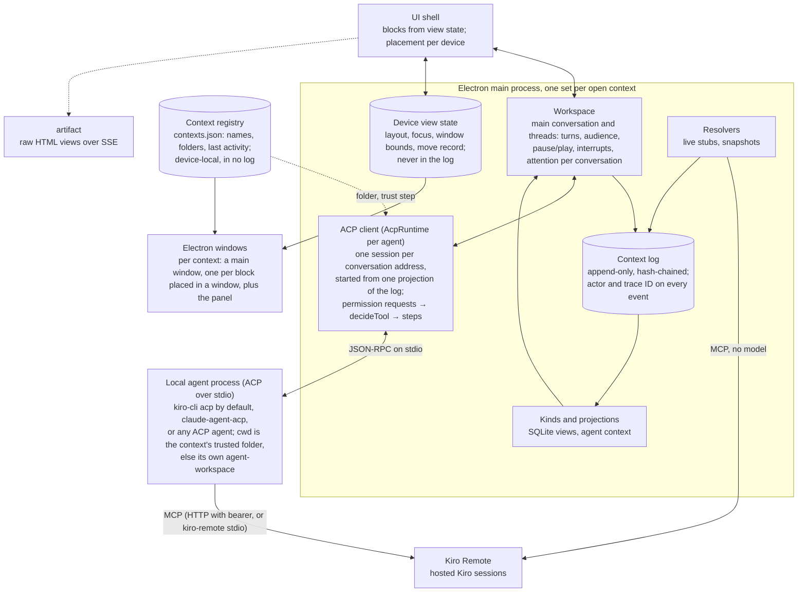
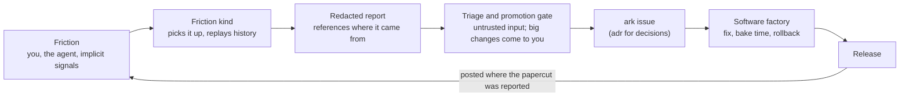

# draft: implementation

How draft is built right now. The model it implements, which stays true however it is built, is in [model.md](model.md). Technology choices will move into ADRs over time; this file summarises and links them.

## Agents over ACP

draft is an ACP client. It speaks the Agent Client Protocol (protocol version 1, through `@agentclientprotocol/sdk` 2.x) to whatever agent runs a conversation, so the agent is configuration, not code. Built in slice 2: `AcpRuntime` in `apps/desktop/src/main/acp/`.

- **Local Kiro is the default.** draft starts `kiro-cli acp --agent-engine=v3 --auth-method=cli`, and Kiro keeps its own sign-in, models and MCP servers, so draft never handles a credential ([Kiro: migrate an ACP client to CLI V3](https://kiro.dev/docs/cli/v3/acp-migration/)).
- **Claude runs through `claude-agent-acp`,** the ACP adapter for the Claude Agent SDK, with a Claude Console API key that the adapter reads from `ANTHROPIC_API_KEY` in the environment draft starts from ([claude-agent-acp](https://github.com/agentclientprotocol/claude-agent-acp)). draft stores no agent credential.
- **Any other ACP agent works** without changes to draft: `agent` and `agents` in `config.json`.
- **Sessions are keyed by conversation address,** so each thread can be its own ACP session, even on different agents. Every session starts from one projection of the log, never the agent's own memory (ADR h89hcrk6).
- **Every agent is made to ask.** draft switches Kiro's autopilot off and Claude's mode to `default`, without Claude's user settings or built-in tools, and won't start a session the agent won't take that on. Permission requests go through `decideTool`, so an approved call that changes something is a durable step before the agent proceeds. A call that runs without asking is logged as `agent.anomaly` and shown as an interrupt (ADR 06wp7907).
- **The agent runs where its context says.** Its working directory is the folder a person trusted for the context, or the context's own `agent-workspace` until then ([Contexts](#contexts)). It has no `fs` or `terminal` capability. Kiro Remote's tools are handed over in `session/new` over HTTP with a bearer header (or the `kiro-remote` stdio client when the agent has no HTTP MCP), and in a trusted folder draft's own file and shell tools come with them (next bullet).
- **The agent has no built-in tool that changes things, and gets draft's own instead.** Asking through `session/request_permission` isn't enough: with a user-wide `capability: all` allow rule Kiro never asks (the rule is the person's, on purpose), and draft saw a write or a shell command only afterwards, as a call without asking. So in draft's sessions the agent's own write and shell tools don't exist, and the file and shell tools it has are draft's (ADR on running the agent without built-in tools that change things, issues aefrmdf4 and 562p472b):
  - *One registry, one policy.* `DRAFT_TOOLS` and `toolPolicy(tool, input, context)` in `packages/core/src/agent-tools.ts`: `read_file`, `list_files`, `search_files`, `write_file`, `edit_file`, `run_command`. The policy is pure over a tool, an input and a context (the trusted folder and how paths resolve) and returns `read` (runs, is logged), `change` (a step: asks, runs only on yes) or `refused` (never runs). Every path is resolved to its real path first, so a symlink out of the folder is outside it. Writes under `.git`, `.kiro`, `.claude` and `.vscode` are refused. A command is `read` only if it is one plain command on the allowlist (`READ_ONLY_COMMANDS`: `git status`, `log`, `diff`, `show` and a few more, `ls`, `cat`, `rg`, `grep` and a few more) with every path argument inside the folder and none of the flags that write, run another program or follow a link out; anything else asks. New tools add an entry, never a second path.
  - *draft's own MCP server* (`apps/desktop/src/main/acp/draft-server.ts`) listens on 127.0.0.1, answers MCP over HTTP with JSON responses, and gives each session its own bearer token in `session/new` (a request with another token, another `Host` or an `Origin` is refused). A call is gated there, whatever the agent's rules say: the server applies the policy, the turn's mapper asks the person through the same interrupt as any step (`askAndBegin`) and begins the durable step, `FolderTools` runs it in the folder with the agent's environment (no sign-ins of the person's) and a time limit, and the step's settlement is the exit code, an output excerpt and the files changed (git's view of the folder). A request that arrives again with the same JSON-RPC id, tool and input within a turn gets the first result and nothing runs twice. If the agent hangs up while the person decides, the call is not run. When the agent also sends a permission request for one of these calls (Kiro does in a folder it hasn't trusted), draft answers it with the one-time allow and the person is asked once, by draft. The tools are offered only to an agent whose own are taken away (Kiro, Claude) that can reach an HTTP MCP server, and only in a trusted folder; in any other session the agent is told it has none.
  - *Kiro* starts with draft's own agent (`kiro-agent.ts`), named `draft-` and 16 random hex digits kept in `<data>/kiro-home/agent-name`, so a project's own agent can't have its name: `tools: ["@mcp"]` (no built-in tool), `includeMcpJson: false`, and deny rules for `fs_write`, `shell` and `subagent`. Kiro CLI V3 reads agents from `~/.kiro/agents`, a trusted workspace's `.kiro/agents` and `$KIRO_HOME/agents`, and `session/new` picks one with `_meta.kiro.modeId`; `kiro-cli acp` takes no `--agent` in V3 ([ACP client migration](https://kiro.dev/docs/cli/v3/acp-migration/), [custom agents](https://kiro.dev/docs/custom-agents/)). draft writes the agent in `<data>/kiro-home/agents/draft.json` and starts Kiro with `KIRO_HOME=<data>/kiro-home`, so no file of the person's is edited. A permission rule decides what a tool may do and not which tools exist: "The tools field decides which tools the agent can see and call; the permissions field decides what those tools may do when called" ([configuration reference](https://kiro.dev/docs/custom-agents/configuration-reference/)), so the person's `capability: all` allows nothing the agent doesn't have. The cost of `KIRO_HOME` is that Kiro's configuration, sign-ins and sessions move with it ([settings reference](https://kiro.dev/docs/reference/settings/)): the person's permission rules, MCP servers, steering and skills don't reach draft's sessions, and Kiro is signed in there once (`KIRO_HOME=<data>/kiro-home kiro-cli login`, which draft says when Kiro isn't signed in). If the session doesn't report that name as its agent, draft doesn't start it. A project's `.kiro/agents` is still read over ACP (see [Contexts](#contexts)), but its agents have other names and `includeMcpJson: false` keeps the project's MCP servers out of draft's agent.
  - *Claude* starts with `_meta.claudeCode.options` `{ settingSources: [], tools: [], disallowedTools: [...] }`: no user settings that could allow tools, no built-in tools, and Bash, the file-writing tools, Agent and the web tools denied by name as a second lock. A bare name in `disallowedTools` removes the tool from the model's context and a deny rule holds in every permission mode, `bypassPermissions` included ([Agent SDK permissions](https://code.claude.com/docs/en/agent-sdk/permissions#allow-and-deny-rules)).
  - *What the agent is told* is derived from the same registry (`toolsBriefing`): the tools the session offers and that changes ask, or that it has none. It is also told that a tool of its own that changes something without asking is a fault: such a call is still recorded as `agent.anomaly` and shown as a call without asking.
  - *Kiro's own calls still carry no structured identity.* Kiro's documentation names one only for MCP tools (`_meta.kiro.mcpTool`) and says never to derive a built-in tool's identity from its title ([ACP client migration](https://kiro.dev/docs/cli/v3/acp-migration/)), so "Tool Load" is still recognized by its shape (issue 562p472b).
- **The agent's process doesn't get the person's sign-ins.** It runs as the person's operating-system user, so `agentEnvironment` (`apps/desktop/src/main/acp/environment.ts`, ADR zan5vjwz, issue xh46a2ks) builds its environment from the person's: draft's own settings, GitHub, git, SSH, AWS and npm credentials are withheld by name, and gh, git, ssh, aws and npm are pointed at empty files in `<data>/agent-env` and a PATH with an `ssh` stand-in first, so they find nothing. HOME, PATH, locale, `KIRO_*` and `XDG_*` pass, so Kiro keeps its own sign-in. `agents.<name>.passEnv` in `config.json` hands one variable through on purpose. The agent's status shows "Your GitHub, git, SSH, AWS and npm sign-ins are withheld from the agent", with the names on demand and any `passEnv` exception, and the session's `agent.session_started` event carries the same report, names only. draft's own process keeps using the person's git and gh for acceptance. This stops casual use, not a process that reads the person's files; see [Contexts](#contexts) for what the agent can still reach.
- **ACP updates stream into the conversation.** The log's actor names the agent and the model it reports. Usage is what the agent reports (token counts, Kiro's credits, context fill); a turn that reports nothing says so in its span.
- **draft builds on standard ACP.** Agent-specific extensions, such as Kiro's `_kiro/...` methods, are used only when the agent advertises them, so draft never turns into a single-agent client.

Two connections, kept apart:

| Connection | What it's for | How |
| --- | --- | --- |
| draft's own agent | The conversation: answers, actions, artifacts | ACP over stdio, to a local agent process |
| Hosted coding agents | Kiro cloud sessions that draft supervises | Kiro Remote: live stubs and interrupts from draft's resolver, and Kiro Remote as an MCP server for the local agent, so it can launch and steer sessions |

## Architecture sketch

Everything goes through one append-only log per context, and everything on screen is computed from it. Each open context has its own copy of everything below the registry, and a window of its own. It has two outward connections, kept apart: ACP to its own agent, and Kiro Remote to the hosted coding agents it supervises.



- **UI shell** renders blocks from view state. Placement and focus are stored per device, apart from the log, in the device's view-state store: the layout, focus, window bounds and a record of every placement change (block, kind, from, to, when, why). The rules are a pure state machine (`apps/desktop/src/shared/placement.ts`). Only a person's gesture changes the layout: the agent can't.
- **Contexts** are listed in the registry and opened one window each; see [Contexts](#contexts).
- **Windows** are real Electron windows. Each block placed in a window gets one, titled with what it is and where it came from, with its bounds kept per device. Closing one returns the block to the place it came from. The panel is a column of the main window.
- **Threads** are conversations with a parent message. The `Workspace` runs the main conversation and every thread over one log, each with its own turns, interrupts and agent session. The agent is chosen when a thread starts (the default, or another configured agent) and can be switched later; the switch is logged as `agent.selected` and the new session starts from the projection (ADR h89hcrk6).
- **Focus** is a layout state on the device. It minimizes every open block except the focused one and its thread, filters the attention count by conversation ("N in focus, M elsewhere") and restores the layout exactly when it ends. It is entered by a gesture (Ctrl or Cmd + period on the selected block) and left with Esc or the same gesture.
- **ACP client** keeps one ACP session per conversation address (so one per thread), starts each from the log's projection, streams the agent's updates into the conversation, turns its permission requests into prompts and steps, and writes everything to the log.
- **Local agent** is a separate process speaking ACP over stdio: `kiro-cli acp` by default, `claude-agent-acp` or any other ACP agent by configuration. It reaches its tools over MCP, Kiro Remote included.
- **Context log** is the raw layer: append-only and hash-chained, with an actor and a trace ID on every event. Slice 1 built draft's own log; the ark ledger was measured fast enough and stays an option. A torn last line is moved to a sidecar and recorded (ADR 4gwyn86q).
- **Kinds and projections** extract things and edges, build the graph and view state, and run reprocessing generations.
- **Resolvers** turn references to outside things into live stubs, with no model involved, and take a snapshot whenever one is referenced. See [Resolvers](#resolvers).
- **Interrupts** are what needs a person, derived from the log, in one attention order. See [Interrupts and attention](#interrupts-and-attention).
- **State machines** (`packages/core/src/machine.ts`) hold the thread and interrupt lifecycles. See [The state machine module](#the-state-machine-module).
- **artifact** is the escape hatch for raw HTML views, with reload over SSE. Windows are real Electron windows now, not synced tabs.

The agent describes a view using a fixed set of components (a JSON description), not raw HTML. That keeps the grammar stable, makes views safe to render, and lets them update live from references. Raw HTML through artifact is only for what the components can't express.

## Contexts

A context is a log with its projections and view state, a permanent name, and, on this device, maybe a folder its agent works in ([model.md](model.md), "Contexts and the universe"). Decisions: ADRs 17gtag9n (contexts and the registry), 1vey5j12 (where the agent runs, and Kiro's trust), 4e115peq (a window per context) and gw4vxvw4 (references across contexts).

**On disk**, under the data directory (`DRAFT_DATA_DIR`, else Electron's `userData`):

```text
contexts.json                the registry: device-local, written atomically
log.jsonl views.db device.db agent-workspace/      the context "local", where it always was
contexts/<name>/{log.jsonl, views.db, device.db, agent-workspace/}
```

- **The registry** holds per context its name, title, the folder it is bound to, a folder that was asked about and isn't trusted, the name its log's own addresses carry, its last activity (updated on every write) and which contexts were open at exit. A device with no registry gets one holding only `local`; the files already there are not touched. A registry that can't be read is moved aside and rebuilt from `contexts/*/`.
- **Names** are address segments, unique on the device and permanent. A new context is named from its folder (`longplay`, then `longplay-2`); `local` is never handed out.
- **Per context:** log, projection, device view state, window bounds, agent processes and polling. Nothing is shared but the identity, the Kiro Remote connection and the resolvers.

**Binding a folder.** Opening a folder nobody trusted for a context shows a trust step with its real path and git remote (read from the repository's config file, credentials removed, without running git). The answer is `context.folder_decided` in that context's log, with the person as actor: the decision, the remote and a SHA-256 of the path, never the path. The path is kept in the registry only. Declined or unanswered, the context opens without a folder and the agent stays in its own workspace; opening the same folder again asks again.

**Where the agent runs.** The working directory of the agent process and of each session is the trusted folder's real path, read when a process or session starts, so a change applies to new sessions. If the folder is gone, the agent stays in its own workspace and the header says so. The agent is told the folder's name, not its path. draft doesn't mark the folder trusted for Kiro, and over ACP Kiro's own trust doesn't keep the folder's configuration out. Kiro's own configuration of the folder (its agents, MCP servers, skills) is therefore still read; draft's sessions pick draft's own agent by an unguessable name and it takes no MCP server from the folder (see [Agents over ACP](#agents-over-acp)). Checked on 22 November 2026 with kiro-cli 3.5.0 on macOS, in a folder Kiro had never opened: Kiro started the MCP server defined in the folder's `.kiro/settings/mcp.json` and listed the folder's `.kiro/skills`. Its "Trust this workspace?" screen guards interactive sessions only. Whether Kiro asks before a call is decided by the person's own Kiro rules as well as by draft's `autopilot` off: with a user-wide `capability: all` allow rule in `~/.kiro/settings/permissions.yaml`, Kiro wrote a file without `session/request_permission`, and draft saw it only afterwards, as a call without asking (?35).

**What the agent's process gets.** The agent runs as the person's operating-system user, in the trusted folder, with the person's environment minus their credentials (see [Agents over ACP](#agents-over-acp)). It gets no `GH_TOKEN`, `GITHUB_TOKEN`, `AWS_*` credentials or profile, npm token or `SSH_AUTH_SOCK`; `gh` is given a token GitHub refuses (an empty config folder alone would leave the keychain's token reachable, because gh falls back to the keychain entry stored without a user name); git has no system config, no credential helper, no prompts and the identity `draft agent <agent@draft.invalid>`; git over SSH and `ssh` offer no key, agent or configuration. What it can still reach is what the person's files and the keychain hold: `~/.aws`, `~/.ssh`, `~/.npmrc`, `~/.config/gh`, the keychain through `security`, `/usr/bin/ssh` by its path, a credential helper named for one URL in the folder's own git config, and anything else the person can read. The boundary against those is a sandbox for the agent's shell. Kiro's local command sandbox (Seatbelt on macOS, off by default) is switched on only through the person's `sandbox.json` or `/sandbox`: Kiro's ACP documentation offers no per-session option, and draft never writes the person's Kiro files, so draft doesn't turn it on.

**Opening a context.**

- *By sentence.* "open longplay" (a context on this device) and "new context for ~/code/x" are recognised by draft, posted for people only, and become one action to confirm. The agent can't open anything. Confirming records `context.crossed` (`opened`, via sentence).
- *From the recent list* in the title bar, with "Open a folder…" and "Import a data directory…".
- *With a path at launch.* `draft <folder>` opens or makes that folder's context. A second launch hands its folders to the running app (single-instance lock) and exits. From the dev script, use absolute paths, because the app runs in `apps/desktop`: `pnpm --filter @nikovirtala/draft-desktop dev -- "$HOME/code/longplay"`. Packaging is issue cwrr4ff1. With no path, the contexts open at the last exit open again, else `local`.
- *Importing a `DRAFT_DATA_DIR` setup.* `draft --import <dir>` or the menu. The old log is verified and copied byte for byte into a new context (the original is only read), and importing the same directory again finds the context. The old log says `local` in its addresses and can't be rewritten, so the registry's name for it differs from the name its addresses carry; people use the registry name. If its `agent-workspace` was a symbolic link, its target is offered through the trust step.

**Across contexts.** An address of another context's item typed in a message (`<context>/<conversation>/<item>@1`, copied with "Copy ref") becomes a reference with a snapshot of its context, address, title, version and event hash, taken by draft from the other log (read only, verified) and never polled. Snapshots are in the referencing log; the agent's context leaves them out until a person pulls one in, which ends the conversation's running session so the next starts from the log with it. Referencing, following, pulling in and opening are `context.crossed` events. Only a person's own messages create references; the agent's words never make draft read another log.

**Windows.** One main window per context; opening an open context focuses it. Closing a context's window ends that context; the last one ends draft (not on macOS).

**Work in the folder.** In a context bound to a trusted folder the agent has draft's file and shell tools, confined to that folder, and no built-in tool of its own that changes things ([Agents over ACP](#agents-over-acp)). A read runs and is logged, a write, an edit or a command off the allowlist is a step the person answers before it runs, and its settlement says what it did. A context with no trusted folder, or with a folder that has gone, has none of these tools and is told so.

**Left out:** sharing contexts, contexts the agent suggests, the universe view in the map and rebinding or unbinding a folder. See the issues opened with this slice.

## Resolvers

One `Resolver` per reference type, each with a version, `detect` (candidate ids in text), `fetch` (the target's state, `null` when it doesn't exist, a throw when it can't tell) and, optionally, `interrupts` (what in that state needs a person, a pure function of the state). A snapshot is taken when a target is first referenced; `status.observed` is written only when the state changes; polling covers only the stubs on screen, doubles its interval while nothing changes (to a maximum), resets on a change, and a failure is counted in telemetry and never polled sooner than the source asks. The target of each type is in the view schema (`STUB_TYPES`).

| Type | A reference is | The state carries |
| --- | --- | --- |
| `kiro-session` | a 26-character session id | title, status, pending permission requests with their options |
| `pull-request` | `owner/repo#12` or a pull request link; id `owner/repo/pull/12` | check runs and statuses with conclusions, review decision and each reviewer's verdict, requested reviewers, mergeable state, head commit |
| `ark-issue` | `<source>:<id>` (`draft:15cxvdep`, the source names are `arkSources` in `config.json`) or a link to the issue's files | status and resolution folded from the event files, the events with their times |
| `adr` | `owner/repo:adrid`, a configured source name (`draft:9p8jj6p5`) or a link to a decision's files; id `owner/repo:adrid` | status folded from the event files, read at the head of the open pull request in the same repository that touches them (else the default branch), that pull request's checks and head, and the result of `adr verify` there |
| `artifact` | a link to a page on the configured artifact server | title, current version, versions, update time |

An ADR's proposal usually lives on a pull request's branch, so the resolver searches the open pull requests (at most 30, newest first, files listed with ETags) for the one that touches the decision. `adr verify` runs in draft's own clone at that head, once per commit, through the person's tools (below); without a verifier its evidence never turns green.

GitHub: `GITHUB_TOKEN` from the environment, else `gh auth token`, else public access with a note in the main conversation. The client only sends GET and sends the ETag it saw, so an unchanged resource answers 304 (proposed ADR 9p8jj6p5). The artifact server comes from `artifactUrl` (default `http://localhost:4400`, `ARTIFACT_TOKEN` as the bearer).

## Interrupts and attention

An interrupt is something that needs a person, in the conversation it belongs to. Some are computed from other events (a step that started and never finished, a step that failed, a call that ran without asking); the rest are raised by a resolver (`interrupt.raised`, with the time it arose, so its age is derivable from the log) and cleared by it when the source stops needing anyone (`interrupt.cleared`, with a reason). A person settles one with `interrupt.settled`, as themselves; the agent can't, and `kiro_answer_permission` is refused by the tool policy.

- **Order.** Blocking permission requests; then failures (failed checks, merge conflicts, changes requested, failed steps, calls that ran without asking); then acceptance requests (ready work waiting for a yes: after something broken, because a failure may make it moot, and before the rest, because it is what the process is stopped at; ADR ytmnx1br); then what is left to resolve (interrupted steps, a conclusion to confirm); then reviews requested. Oldest first within each, then by place in the log. One count in the title bar, with the whole list under it.
- **Where they belong.** A hosted session's interrupts go to the conversation whose step launched it (the step's result names the session), else the conversation that first referenced it, else the main conversation. Other targets go to the conversation that first referenced them, else the main one.
- **Settling.** A hosted permission request is allowed or denied: draft writes a step of the person's own, calls Kiro Remote as them, and then writes the settlement. An interrupted step is settled as done, failed or retry, naming the started step; retry writes the settlement and a new step (new key, `retryOf`) together, then runs it. The old step is never run again. A failed step is acknowledged or retried. PR events and calls that ran unasked are acknowledged.
- **Keys.** A check's key includes the commit and the check's name, a conflict's the commit, a review's the review, so a new push is a new interrupt and a settled one stays settled while the source reports the same thing.

## Acceptance

One pattern for every human gate (docs/model.md, "Acceptance"), built on the interrupt, the state machine and the step. The ADR and the pull request are the first two kinds of record (`packages/core/src/acceptance.ts`, `adr.ts`, `pull-request.ts`).

- **A kind declares** its evidence (`subject`), what accepting and rejecting do (`effect`, with steps) and the inverse of each (reversible or compensable with a named step, irreversible with a reason). The UI draws whatever evidence a request carries.
- **Ready means green.** The resolver's `interrupts` is pure, so the request exists exactly while every item of evidence is green and is cleared, with the item that went red named, when one does. Its key includes the commit it was judged on: a new push is a new request, an answered one stays answered, and a red-then-green same commit is a new episode.
  - ADR: proposed at the head of an open pull request of its own repository; `adr verify` clean at that head; every check of that pull request passed.
  - Pull request: open, not a draft, every reported check passed, GitHub's mergeable state is clean (which counts the repository's required checks and reviews), no review asks for changes. draft cannot see which checks are required without admin rights, so it asks for all of them.
- **Three answers.** Accept: the ADR's accept commit is made as the person, signed, on the proposing branch; merging that pull request is a second acceptance, a pull request merges by rebase at the head the person saw. Request changes: the note becomes a message to the agent in the thread and the request waits for new evidence. Reject: with a reason, `adr reject` (signed, on the branch) or the pull request closed with a comment.
- **A step of the person's.** Accept and reject look at the target again first and refuse, doing nothing, if the evidence is no longer the green evidence shown. Then `step.started` (key), the action, `step.completed` with the resulting commit or merge SHA, the evidence as it was and the declared inverse, then `interrupt.settled` as the person. Nothing executes an inverse yet.
- **Only a person.** The kind's machine marks accept, reject and request-changes person-only; `proveOnlyPersonFires` proves every other actor is refused from every state. The tool policy refuses any tool, from any MCP server, whose name accepts, rejects, approves or merges (`isPersonOnlyTool`), without asking.
- **The write path.** The read client stays read-only (ADR 9p8jj6p5). Writes are `PersonTools` (`packages/core/src/person-tools.ts`, ADRs wkcnp3zr and k8af6zrg): the person's own `git` (identity, signing key and credential helper from their config; draft turns signing on for the commit and does not push an unsigned one), `gh api` (REST, gh's own sign-in) and `adr`, started without `ARK_AGENT` and `ARK_ON_BEHALF_OF`. The git work is in clones under `<data>/acceptance`, as detached worktrees at the commit judged, never in the person's working copies or a context's trusted folder, and beside `contexts/`, not in it (the clones serve repositories, not contexts; a request's events, steps and interrupts go to the log of the context whose conversation it lives in); the push is never forced, so a branch that moved is refused. draft never reads a key or a write token. `config.json` takes `gitRemotes` for repositories that are not on GitHub.
- **Local prompts have an age.** `agent.permission_asked` is written before a local permission prompt shows, and the prompt takes its time.
- **Idempotency keys.** Each step's key goes to a Kiro Remote tool that changes something when that tool's input schema advertises `idempotencyKey`. Only calls draft makes itself carry it (the person's own steps); a real ACP agent builds its own calls.

## Thread lifecycle

A thread is open, concluding (its agent drafted a conclusion and it waits for a yes), wrapped up, superseded or withdrawn. "Wrap this up" (or the Wrap up button) makes the thread's agent draft a conclusion; draft records it as `thread.conclusion_proposed` with citations (the thread, its branch point, its message count and what it produced). One confirmation, `thread.wrapped_up` as the person, returns it to the conversation the thread branched off, shown at the thread's stub and given to that conversation's agent. Declining reopens the thread. Superseded and withdrawn need a reason. Closing on production use comes later.

## The state machine module

`machine.ts` declares a machine as data: states (active, waiting with an owner and a timeout, terminal), transitions with a trigger and the actors who may fire each, and standard ends (`dismissed`, `superseded`, `withdrawn`) that need a person and a reason. `checkMachine` refuses a machine with an unreachable state, an open end, a wait without an owner or timeout, a way out of a terminal state or a transition nobody may fire. `Machine.next` checks the trigger, the actor and the reason, and `replay` runs a log through a machine and reports what it didn't allow (counted as `draft.machine.violations`). The interrupt machine of each kind and the thread machine are built on it; kinds will be.

## Data model

JSON inside, markdown at the edges. Everything draft derives is stored as polymorphic JSON. Markdown is a rendering: an export, a view, the agent's working format, and ark's format in git. It is never the stored data.

Why:

- **Stable identity.** References, comments, snapshots and edges point into documents. Markdown has no stable IDs, so a reference into a paragraph breaks when the text moves. A JSON document tree gives every node an ID that survives edits.
- **Kinds need typed fields.** State machine guards check fields, not prose.
- **Structural diffs.** Generation diffs, revert and audit need "this node changed", not a line diff.

### The envelope

Every item has the same envelope, and its kind carries the body. Items are a Zod discriminated union on `kind`, built from the kind registry, so a new kind brings its own schema.

```json
{
  "id": "…",
  "kind": "assumption",
  "kindVersion": 2,
  "context": "ark",
  "actor": "kiro-local",
  "trace": "1b64…",
  "state": "load-bearing",
  "body": {
    "statement": ["document nodes, each with an id"],
    "evidence": []
  }
}
```

Rich text inside a body is a document tree: paragraphs, headings, lists, and references as inline nodes, each with its own ID.

### Rules

- **Raw stays raw.** An imported file keeps its original bytes, markdown included, because reprocessing with a new kind needs the original. Everything derived from it is JSON.
- **ark records stay markdown in git.** PR diffs, GitHub and agents read markdown well, and git is the source of truth for records. draft keeps a JSON mirror and writes markdown out deterministically; an edit made in git comes back through import, parsed into nodes and diffed. Identity across that round trip is the identity spike in the prototype plan.
- **The agent works in markdown.** It sees a markdown projection with references as tokens and writes markdown back, which draft parses into nodes. The model gets the format it handles best; the store keeps the structure.
- **Versioned bodies.** Every body carries `kindVersion`. Old versions are upcast on read; the log is never rewritten.
- **Canonical JSON for the hash chain.** Events are canonicalized (RFC 8785, JCS) before hashing, so key order can never break the chain.
- **Unknown kinds are kept.** An item whose kind this build doesn't know is stored intact and shown as a generic block, so older clients and other contexts lose nothing.
- **Plain SQL on top.** Items live in SQLite as JSONB, with generated columns and indexes on the envelope fields, so process invariants and the map stay plain SQL.

### Facts, kinds and standing

The three categories from [model.md](model.md#facts-kinds-and-standing) are an envelope field, so most checks are a query over the one log, not code that knows every kind.

- **Category beside kind.** The envelope's `kind` names an item's schema; a new `category` field (fact, kind or standing) says which store it belongs to. The kind registry declares the category of each schema, so Measurement and Usage are facts with no states, and Term is standing.
- **Standing fields.** A standing item carries `decision` (the accepted decision it came from), `tripwire` (the reopening condition, as text plus an optional predicate over facts), `scope` (universal, workspace, a context, or path globs as in `adr for <path>`), `rung` (principle, guideline or check) and `restsOn` (dated findings, each with `checkedAt` and `validUntil`).
- **Guards name what they read.** A transition guard references standing by id, and the registry records which guards read which standing, so "unread" is a query, not a judgement.
- **Fitness checks are a registry of pure functions** from a graph snapshot to findings, reusing ark's finding shape (severity, a `<area>/<name>` rule, a message, a subject): `fact/unsourced`, `standing/orphaned`, `kind/open-end` and so on. Every run appends its findings as facts. A failure with no open instance opens one, keyed by rule and subject, so a rerun never duplicates it; the instance closes when a later run shows the finding gone, with that run as evidence.
- **Three triggers.** The intake gate checks the candidate and its neighbours synchronously. Every append rechecks the subjects it touched. A scheduled sweep, a durable timer, catches expiry, timeouts and evidence that no longer resolves.
- **Acceptance is enforced in the machine.** Accepting standing or a new kind requires a person as the actor; an agent's attempt is refused by the transition, not hidden by the UI.
- **The importer is source adapters plus a review.** Agent files are split by heading and bullet into candidates; lint, commitlint and CI configuration are parsed into checks; ADRs and issues come through the `adr` and `issues` JSON views; pull request sections come from GitHub; facts from git. A candidate's key is a hash of its path and canonicalized span, so reruns are idempotent. Links between a guideline and the check that enforces it are proposed edges, reviewed like anything else. A dry run reports counts by category and writes nothing; only applying a review writes.
- **longplay is the golden test.** The classified candidates from a pinned longplay commit are a committed fixture; a change to intake shows up as a diff to it.
- **Axioms live in code,** in one module outside the registry, each with a test, so changing one is a code review, not a decision in the log.

## Testing the process

The invariants are in [model.md](model.md). This is how they run.

- **As queries.** Invariants are recursive SQL over the SQLite log and edge tables, not a new query language.
- **On fixtures.** A recorded log is a fixture. Rehydration is deterministic even though the conversation wasn't, so golden logs replay the same way every time.
- **End to end.** One scripted loop with a fake ACP agent and a fake factory runs conversation → candidate → ADR → issue → session → PR → acceptance → release → signal → answer, and asserts that the cycle closes.
- **In production.** The same queries run continuously in draft. A broken invariant is operational feedback for the component that owns it, and goes up the ladder like any other.

## Built-in feedback loop

The tool improves itself the same way ark does: friction gets reported where it happens, and a papercut is fixed before the next session runs into it. Its own development is a context inside the tool, so the loop runs on the tool's own grammar.



When a release fixes a papercut, the message is posted in the conversation where it was reported, as a reference to that spot.

Where reports come from:

- **You**, in plain conversation ("this is annoying"). No separate feedback button: a friction kind picks it up.
- **The agent**, instructed to report its own papercuts: a failing tool, a missing kind, a reference it couldn't resolve. Same practice as ark's agents.
- **Implicit signals** that nobody has to report:
  - views that fall back to raw HTML, which means the component set is missing something
  - placements you undo right away
  - extractions you keep correcting
  - resolver errors
  - threads that stall

How it fits the rest of the design:

- **Friction is a kind.** Introducing it replays the whole history, so papercuts felt before the kind existed get found too.
- **Reports cross a context boundary**, so a report is a redacted snapshot with a reference back to where it came from. Nothing else from that context leaks out.
- **Reports are untrusted input.** They can carry prompt injection, so they go through the same triage and promotion gate as in ark, and dramatic changes still come to you.
- **The development context uses ark directly:** issues for papercuts, adr for decisions, and the software factory for fixes, with bake time and rollback on release.
- **New kinds and components come from the same loop.** Repeated raw-HTML fallbacks suggest a component; repeated corrections suggest a better kind version.

Open question: what counts as a papercut automatically, and what needs your confirmation first?

## Non-functional requirements: observability and audit

The implementation must be fully observable (usage and diagnostics) and auditable. Most of the audit comes from the design itself, because every change is already an event in an append-only log. Observability has to be built in from the first commit.

### Audit

- **The context log is the audit trail.** Messages, decisions, agent actions, tool calls, permission answers, page reads, reprocessing runs and promotions are all events in it. Nothing changes state outside the log.
- **Every event has an actor:** you, the agent of a given thread (with model and version), a kind (with version), a resolver, or the factory. The agent never acts under your identity.
- **Every agent action records its grounds:** the references it loaded as context, the tools it called and their results. "Why did it do that?" is answered from the log, not by guessing.
- **Cross-boundary access is recorded:** each read across contexts, each web page read, each report sent to the development context.
- **The log is tamper-evident.** Events are hash-chained, which the git-backed ledger gives for free, so a rewritten history shows.
- **Interpretations are auditable too.** Every extracted item names its raw source, kind version and model, and every generation promotion records what changed and who approved it.

### Observability

- **One trace per turn.** A trace ID follows a message from the UI through the ACP session, the agent's tool calls and permission requests, resolvers and kinds. The same ID is stamped on the log events the turn produced, so diagnostics and audit join up.
- **OpenTelemetry for traces, metrics and logs,** exported to whatever backend is at hand. Locally a collector is enough; on AWS the usual managed services.
- **Usage is measured:** placements, references, threads, kinds in use, feedback signals. These metrics also feed the built-in feedback loop.
- **Cost is measured:** tokens and model time per turn, thread, context and reprocessing generation, as far as the agent reports them over ACP, checked against the configured budgets.
- **Health is measured:** latency per step, resolver freshness, failed and retried tool calls, raw-HTML fallbacks, reprocessing backlog.
- **Telemetry carries IDs and numbers, never content.** Message text, artifacts and page contents stay in their context's log, so observability never becomes a way around the context boundary.
- **Usage carries its version.** Usage metrics have the running SHA as a dimension beside route, operation, event name and flag, so a change can be matched to its use. Few versions run at once, so the extra dimension is cheap.

## Deploy provenance

The pipeline stamps, draft reads. The model is in [model.md](model.md), under "From running code back to its thread".

- **In the telemetry.** The deploy pipeline sets OpenTelemetry resource attributes: `service.version`, `vcs.ref.head.revision` (the commit SHA), `vcs.repository.url.full` and `deployment.environment.name`. The VCS attributes are still in Development status in OpenTelemetry's semantic conventions, so their names may change ([VCS attributes](https://opentelemetry.io/docs/specs/semconv/registry/attributes/vcs/)).
- **On AWS.** CloudWatch Application Signals emits deployment events at startup and every 24 hours, enriched by `OTEL_AWS_SERVICE_EVENTS_GIT_COMMIT_SHA`, `OTEL_AWS_SERVICE_EVENTS_GIT_REPO_URL`, `OTEL_AWS_SERVICE_EVENTS_DEPLOYMENT_ID`, `OTEL_AWS_SERVICE_EVENTS_DEPLOYMENT_TIMESTAMP` and `OTEL_AWS_SERVICE_EVENTS_DEPLOYMENT_URL`. It supports Java, Python and Node.js and is disabled in Lambda, where the resource attributes do the job ([Application Signals service events](https://docs.aws.amazon.com/AmazonCloudWatch/latest/monitoring/CloudWatch-Application-Signals-ServiceEvents.html)).
- **The deployment ledger.** CI creates a GitHub deployment for the SHA and environment and sets its status. draft's deployment kind reads deployments and deployment statuses through a resolver ([GitHub deployments API](https://docs.github.com/en/rest/deployments/deployments)).
- **The deployment range.** The commits between the previously deployed SHA and the new one, and the PRs they belong to.
- **Diff to signal.** A kind maps a PR's changed files and functions to the routes, handlers, events and flags they affect, so the matching usage on the new SHA can be found. Where the diff maps to nothing observable, the agent proposes a named signal or "close on deploy".
- **The factory needs nothing new.** It merges as it does today.

### Line-level evidence

Three tiers, trading cost against precision:

| Tier | How | Gives | Cost and caveats |
| --- | --- | --- | --- |
| Function level, always on | Spans carry the stable code attributes `code.function.name`, `code.file.path` and `code.line.number`, plus the version | Which changed functions ran on the new SHA | Cheap; covers only code that has spans |
| Line level, sampled | The OpenTelemetry profiles signal: sampled stacks, linked to the active trace and span, with the version | Hit lines per SHA on hot paths | Low cost; a hit is proof, a miss isn't. The signal is in public alpha (March 2026) and not yet for critical use |
| Line level, precise, on a slice | V8 precise block coverage (`Profiler.startPreciseCoverage`) on one instance or a share of invocations, for a window after the deploy, then off | Exactly which blocks of the changed code ran | Bounded overhead during the window, like a canary |

- **Source maps.** Runtime lines are JavaScript; every release ships its source maps so hits map back to the TypeScript lines in the diff.
- **The timeout's evidence.** At the usage timeout, changed executable lines with no hit in any tier trigger the agent's question; [model.md](model.md) has the rule.

Sources: [code attributes](https://opentelemetry.io/docs/specs/semconv/registry/attributes/code/), [profiles signal](https://opentelemetry.io/docs/concepts/signals/profiles/), [V8 code coverage](https://v8.dev/blog/javascript-code-coverage).

## Technology choices

The first live prototype is a local, single-user desktop app in TypeScript, built mostly from parts that already exist. Versions are the latest major releases as of 20 November 2026.

| Layer | Choice | Version | Why |
| --- | --- | --- | --- |
| Runtime for tooling | Node.js | 26 LTS | The current LTS line. The app itself runs on the Node that Electron bundles (24.22 in Electron 45). |
| Language | [TypeScript](https://devblogs.microsoft.com/typescript/announcing-typescript-7-0/) | 7.0 | The native Go compiler: 8 to 12 times faster builds. |
| Package and tool versions | pnpm, mise | pnpm 12 | The existing setup. |
| Desktop shell | [Electron](https://releases.electronjs.org/) | 45 | Real windows and native web views for the built-in browser, TypeScript all the way down. |
| Build | electron-vite with Vite | 6 with 8.3 | What slice 1 found current on 20 Nov 2026. |
| UI | [React](https://react.dev/blog/2026/09/09/react-19-3) | 19.3 | Renders the fixed component set from view descriptions. |
| Schemas | Zod | 4 | View descriptions, events and tool inputs. |
| Agent protocol | [ACP TypeScript SDK](https://agentclientprotocol.com/libraries/typescript) (`@agentclientprotocol/sdk`), client side | 2.8 (ACP protocol version 1) | One protocol for every agent, one session per conversation address. Slice 2. |
| Agents | Kiro CLI (`kiro-cli acp --agent-engine=v3 --auth-method=cli`), and Claude through [`claude-agent-acp`](https://github.com/agentclientprotocol/claude-agent-acp) | Kiro CLI 3.5, claude-agent-acp 0.109 | Local Kiro by default, with its own sign-in; Claude by configuration, with a Console API key from the environment. |
| Hosted coding agents | Kiro Remote | current | Live stubs and interrupts from draft's resolver, and an MCP server for the local agent. |
| GitHub and artifact pages | REST API, read only; the artifact server's JSON API | 2022-11-28 | Pull request, ADR and ark issue stubs; no SDK, `fetch` with ETags. Writes only through the person's own `git`, `gh` and `adr`. |
| The tool's own MCP server | MCP TypeScript SDK | 1.32 | Exposes contexts to other agents and to Claude. |
| Raw log | draft's own append-only, hash-chained log | slice 1 | The ark ledger measured about 5 ms per message and stays an option; slice 1's PR records why draft started with its own. |
| Views and graph index | SQLite through [node:sqlite](https://nodejs.org/docs/latest/api/sqlite.html) | built in (release candidate) | No native module to rebuild for Electron. |
| Telemetry | [OpenTelemetry JS SDK](https://opentelemetry.io/blog/2026/otel-js-sdk-3-0/) | 3.0 | Traces, metrics and logs are all stable in JavaScript. A local collector for now. |
| Raw HTML views | artifact | v1 | The escape hatch, with reload over SSE. |

Left out of the first prototype: sharing contexts, imports of other sources, kinds and reprocessing, AWS deployment and sign-in.

Native Swift stays the candidate for version 2, once the grammar has settled. Tauri was passed over because it adds Rust and embedding external sites inside a panel is still rough there.

## Claude and claude.ai

Claude is one of draft's agents. It runs through claude-agent-acp, the ACP adapter for the Claude Agent SDK, with a Claude Console API key. Anthropic's docs say apps built on the Agent SDK must not offer claude.ai sign-in unless Anthropic has approved it, so the API key is the way ([Agent SDK overview](https://code.claude.com/docs/en/agent-sdk/overview)).

What could carry over by itself: on the Agent SDK, Claude loads skills, memory files and plugins from `~/.claude` and from the project's `.claude` folder, the same way Claude Code does. Slice 2 launches the adapter with `settingSources: []`, because those settings can also allow tools without asking (ADR 06wp7907), so none of it loads yet. Loading skills and memory without the permission settings is a follow-up; once it lands, the skills in `nikovirtala/skills` work in the tool as they are.

What doesn't carry over: claude.ai memory, past chats, artifacts and claude.ai connectors. They live in claude.ai and can't be reached through the API. Three bridges cover the gap:

- **The tool as an MCP server for Claude.** It exposes contexts as tools: read, search, reference, append. Locally it's added to the Claude desktop app. Later it runs on AWS with OAuth 2.1, like Kiro Remote, as a custom connector, so Claude on any device works in the same contexts.
- **Claude's history as a source.** The claude.ai data export is imported into a context as raw data, and a conversation kind turns past chats into threads and references. This is the import pipeline doing its normal job.
- **Shared tools.** Your own MCP servers (Kiro Remote, ark, Longplay) connect to both the tool and claude.ai, so both see the same sessions, issues and decisions.

Going forward, the context graph replaces memory inside the tool, with better guarantees: everything has a source, a version and an actor.

## Prototype plan

The first job to test: supervising the software factory's Kiro sessions from one conversation, without opening Kiro, GitHub or anything else. It has real stakes, clear interrupts and daily use, so it shows quickly whether the mental load actually drops.

1. **Diary week.** Use Claude with the Kiro Remote MCP and artifacts as a rough version of the tool. Write down every moment you have to leave, or lose track. That list becomes the spec, and the first run of the feedback loop.
2. **Slice 1: log and live Kiro session stubs.** Built in draft PR #1, proven against fakes: the hash-chained log with an actor and trace ID on every event, projections, the Kiro session resolver, the conversation UI and telemetry. Its agent ran in-process on the Agent SDK.
3. **Slice 2: agents over ACP. Done.** One ACP client runtime: local `kiro-cli acp` by default, `claude-agent-acp` as the alternative, sessions keyed by conversation address and started from one projection of the log, permission requests as steps, unasked calls as interrupts. The Agent SDK runtime is gone. Every message carries its audience, and the agent can be paused and played. A half-written last line of the log is moved aside instead of refusing the log. Proven against a scripted ACP agent over stdio, and in one real turn with kiro-cli.
4. **Slice 3: blocks, placements and focus. Done.** Inline, minimized, panel and a real Electron window, threads branched off any message with their own agent session and a live stub at the branch point, and focus. Placement and focus are per-device view state and survive a restart. Proven on two scripted ACP agents in Electron.
5. **Interrupts and attention. Done.** Kiro Remote permission requests, PR events, failed and interrupted steps arrive in the thread they belong to, in one attention order with the local agent's own requests, and are settled there as you. Live stubs for pull requests, ark issues and artifact pages. A thread wraps up and its conclusion returns to the main conversation. Thread and interrupt lifecycles run on one state machine module. Proven against a fake Kiro Remote, a fake GitHub and a scripted ACP agent in Electron.
5a. **Contexts bound to folders.** Several contexts on one device, each with its own log, view state, agent and window, listed in a device-local registry. A folder a person trusted is where the context's agent works; the existing log stays as `local`. Opened by sentence, from a recent list, with a path at launch or by importing an older data directory. References across contexts keep a snapshot and are recorded as crossings. Proven in Electron on the scripted ACP agent.
5b. **Acceptance. Done for ADRs and pull requests.** An interrupt kind ranked after failures, shown only with green evidence its kind declares, answered as you with your own git identity, signing key and gh sign-in: accept (an ADR is a signed commit on its pull request's branch, merging is a second acceptance), request changes (a message to the agent) or reject with a reason. Person-only transitions proven by the checker, every effect with its declared inverse, an ADR resolver, step idempotency keys where Kiro Remote advertises them, and an age in the log for local permission prompts. Proven against a local bare git repository and a fake GitHub with a test identity and SSH key, and in Electron. Left for later: accepting issues, drafting records from conversations, executing reverts.
6. **Graph, linear view, import.** The identity spike comes right before the first kinds: decision, task and design candidates from conversations, promoted into ark records, with a replay over the existing history.
7. **Multiplayer.** A shared, hosted log, identities and sign-in, the driver role and personal notes.

Each step is usable on its own, and the diary week may reorder the rest.

## Open questions

- [ ] The prototype runs on Electron. Does version 2 move to a native shell, close to Two Voices, once the grammar has settled?
- [ ] Can the ark ledger hold both the conversation log and the interpretation events?
- [ ] How do extracted items get stable IDs: derived from the source, or a matching step after extraction?
- [ ] What's the cost budget for reprocessing, and does it run only when a context is opened?
- [ ] What does draft show for cost when an agent doesn't report token usage over ACP? Slice 2 records only what is reported (Kiro reports credits and context fill, not tokens) and shows nothing yet.
- [ ] Where does the shared log live for multiplayer?
