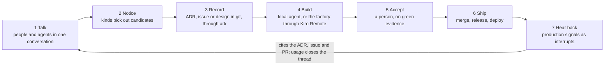
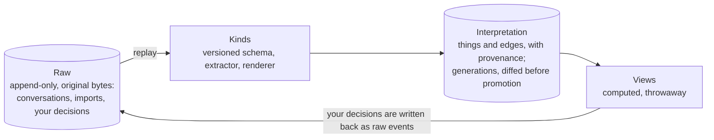
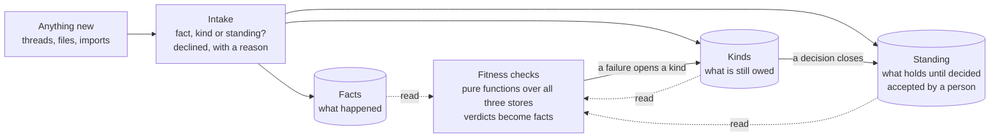

# draft: model

Niko Virtala, 20 November 2026. Written in the draft design doc and exported here.

What draft is, however it is built. How it is built right now is in [implementation.md](implementation.md).

## Context and problem

Everything should fold around the conversation, threads and references: you ask and describe, the agent delivers. The UI builds itself as the work goes, the same way agent harnesses build the tools they need.

The problem it solves is switching between tools. Every tool is another mental model to hold, and holding several at once is cognitively expensive. Kiro Crew adds to that, with something going on everywhere at once.

One mental model that keeps getting better beats many models held side by side. So the grammar of the UI stays small and fixed, and only the content is generated.

## Name

The tool is called **draft**. The name has to work in speech, so it carries several meanings at once:

- **A first version.** Nothing in the tool is final. Views are recomputed, history is refolded, and the map keeps changing, so it's always a draft. The point is the journey, not the destination.
- **A drawing.** A draftsman draws plans and maps.
- **A ship's draft.** It sails alongside ark.
- **Drafting someone into the work,** the way a thread brings in an agent or a Kiro session.

In packages it's `@nikovirtala/draft`. Drafts, a long-running iOS and Mac app for capturing text, is a near collision to keep in mind if this ever becomes a public app.

## Goals and non-goals

The prototype has to prove that one conversation can replace the tool hopping. The non-goals below are proposed boundaries for the first version.

Goals:

- One mental model: a small, fixed grammar whose content is generated.
- No permanent chrome. Controls appear in context and go away when they're used.
- Supervise many agent sessions from one conversation, without opening other tools.
- Work with any ACP agent: local Kiro by default, Claude or another agent by configuration.
- Everything can be addressed and referenced, and the references form a graph.
- Outside data can be imported, and all history can be reprocessed when new kinds of things are introduced.

Non-goals for the first version:

- A general chat app, or a replacement for Kiro or Claude.
- Free-form generated layouts. The agent fills blocks; it doesn't invent new layout.
- Real-time editing by several people at once.
- Phone layouts.

## The process

draft is where one way of delivering software takes shape. Its pieces are spread through this doc; this section is the whole loop in one place.

The stages are the familiar ones. What changes is that they all happen around one conversation, and every step cites the one before it. Nothing is handed off between tools; it is referenced.



The loop runs clockwise. The step back to the conversation is the one that makes it a loop rather than a pipeline.

1. **Talk.** People and agents ask, describe and decide in one conversation and its threads. See [Threads](#threads) and [Multiplayer and audience](#multiplayer-and-audience).
2. **Notice.** Kinds pick out decisions, tasks and designs as candidates. Nothing is written yet. See [Knowledge pipeline](#knowledge-pipeline).
3. **Record.** A promoted candidate becomes an ADR, an issue or a design in git, through ark, citing the conversation it came from. See [From conversation to records](#from-conversation-to-records).
4. **Build.** The local agent works in the thread, or the factory picks up the issue in a hosted Kiro session, supervised through Kiro Remote. See the built-in feedback loop in [implementation.md](implementation.md).
5. **Accept.** Every human gate is one pattern: shown only with green evidence, answered by you, signed as you. The agent can't press it. See [Acceptance](#acceptance).
6. **Ship.** Merge, release and deploy. draft observes these as live blocks; it doesn't drive deployment.
7. **Hear back.** Production signals arrive as interrupts in the thread that produced the change, citing the ADR, issue and PR behind it. Evidence that the change is in use is what closes its thread.

What holds it together:

- **One log.** Every step is an event with an actor and a trace ID, so the loop is auditable end to end. See the non-functional requirements in [implementation.md](implementation.md).
- **References, not handoffs.** Each record cites where it came from, and the conversation shows what it produced.
- **Agents build, people accept.** The agent drafts, proposes and builds. Only a person accepts, as themselves.
- **Live blocks, not tool switching.** Sessions, PRs, releases and signals come in through resolvers, in the attention order the conversation already has.

Where it stands:

- **Proven on draft itself.** The built-in feedback loop already closes: a papercut becomes an issue, the factory fixes it, and the fix is announced where it was reported.
- **Deploy provenance.** Designed, not built: the commit SHA is the join key from a running version back to its conversation, and usage per version closes threads. A deployment kind and a signal kind carry it, with typed edges such as "regressed after".
- **The claim.** Today: the delivery lifecycle, folded into one conversation. With the production half: a loop that closes where today's tools stop, at merge.

## From running code back to its thread

The commit SHA is the join key. Running code only has to say which commit it was built from; draft resolves the rest from links it already holds: SHA → the PRs in the deployment → their issues → the ADRs → the conversation.

- **Deployment.** The commits between the previously deployed SHA and this one give the PRs in the deployment, and the threads waiting in *shipped* link to it. The first telemetry carrying the new SHA confirms that the deploy happened.
- **Usage, per change.** Usage metrics carry the version as a dimension beside route, operation, event name and flag. A change's diff says what it touched, so use of those on the new version, after the deploy, is evidence that this change is used. That evidence closes its thread.
- **Down to the line.** The ideal evidence is the changed lines themselves, executed on the new version after the deploy. Only executable lines count: types, comments and imports can't run, a deletion is judged by the code around it, and a type-only change closes on deploy. Paths that are rare by design, such as error handlers and retries, are marked as such and close at function level or by explicit acceptance.
- **When the agent asks.** Inferring is the default. The agent asks only when, at the timeout, changed executable lines that aren't rare by design have never run. That is a finding in itself: the change isn't used, or the code is dead. "The branch you added in `applyDiscount` never ran in 14 days: keep waiting, close as unobservable, or is it dead code?"
- **The exception.** A change that leaves no trace in telemetry (a rename, a config change, infrastructure, a path without spans) gets its signal named, or "close on deploy". The agent proposes it when the diff maps to nothing observable.
- **Numbers, never content.** The dimensions say what was used, never what was in it.

Who writes what: the deploy pipeline stamps the SHA and records the deployment, draft reads both, and the factory needs nothing new.

## Core model: blocks and placements

There is one primitive, the block, and it can live in four places. Everything visible is a block: an artifact, a live status, a thread, the graph view.

| Placement | What it shows | Its controls |
| --- | --- | --- |
| Inline | The block where it was created, as a preview | Minimize, open in panel, pop out |
| Minimized | One line: title and live status | Expand, open in panel, pop out |
| Panel | The full block on the right. A thread continues the conversation there | Pop out, close |
| Window | The full block in its own window, titled with where it came from | Close |

Rules:

- Moving a block never changes its content. Placement is view state, kept apart from the log.
- A moved block leaves a stub where it was created, showing where it went.
- Only one level uses the panel. Anything deeper uses windows.
- The agent may suggest a move but never makes one. Your layout changes only when you change it.
- The icons on each block are the only buttons. Everything else is conversation.
- Placement is kept per device, so a phone can turn "panel" into a full-screen push.

## Focus

Focus folds everything except what you're working on. Every open block minimizes, except the focused one and its thread, and leaving focus restores the layout exactly as it was.

- **Focus is view state,** like placement. It never touches the log, so it's safe to use freely.
- **The focused thing is whatever you last selected or spoke in.** One gesture or one sentence ("focus on the PR thread") enters focus.
- **Interrupts are filtered.** A permission request in the focused thread still shows; everything else only raises the attention count.
- **Focus can also narrow the agent's default context** to the focused item and its neighbours. That's offered as a choice, never done silently.

## Threads

A thread is a block whose content is a conversation. It branches off any message and continues in the panel, while the main conversation stays on the left.

- The main conversation keeps a thread stub where the thread branched off. It shows live state: "2 new", "waiting on you", "1 artifact".
- When a thread wraps up, its conclusion returns to the main conversation as a summary, so decisions don't disappear into threads.
- Blocks made inside a thread follow the same rules but can't take the panel, because the thread holds it. They go inline, minimized or into a window.
- A window popped out of a thread names the thread it came from, and the thread keeps a stub.
- Interrupts are messages. Permission requests, merge conflicts and reviewer verdicts arrive in the thread they belong to, in one attention order across all threads.

**What closes a thread: a measurable sign that what it produced is used in production.** Merged isn't done. The sign is a usage signal (requests to an endpoint, a flag exposure, an event count) traced back to the thread through deploy provenance, carrying numbers, never content.

- After merge and release, the thread waits in *shipped*, with a timeout. Shipped but unused past the timeout is feedback in itself, and surfaces as an interrupt.
- A thread that produces no software closes when what it produced closes: a decision accepted, a question answered, an experiment with its result.
- You can always end a thread as superseded or withdrawn, with a reason, like any other item.

**Which agent runs a thread.** Your default, chosen from the agents available, and selectable when a thread starts.

- **Switching midway is a resume with another agent.** The new agent's session gets a projection of the log, the same path as recovering from a crash. The projection is compact: the thread's open items, decisions, candidates and the references in play, not the transcript. The new agent pulls the rest through references when it needs it.
- **Switching is explicit and logged.** You ask for it and see its rough cost first. The switch is an event, so the audit shows which agent acted from which point.
- **A second opinion is a fork, not a switch.** "Ask Claude about this" opens a sub-thread with the other agent, seeded with the same projection. Its answer comes back as a reference, and the original agent keeps its context.

Rejected alternative: opening a thread's artifact in the panel and pushing the thread out to a window. It's more flexible, but layouts would start rearranging themselves.

## Multiplayer and audience

Several people can take part in one conversation, and every message has an audience: people only, or people and the agent. Everything goes into the log either way, but the agent's context is built only from messages addressed to it. That rule is enforced where the context is assembled, not in the UI, so nothing reaches the model by accident.

The audience comes from the thread's agent state, so a continuous chat with the agent needs no mentions:

| Agent state | Default audience | The agent… | Mobbing analogy |
| --- | --- | --- | --- |
| Paused | People only | doesn't read the thread | People discussing among themselves |
| Listening | People and agent | reads but stays silent, and extracts decisions, tasks and open questions | A scribe |
| Active | People and agent | answers when addressed, and acts when the driver approves | The driver at the keyboard |

- **Only exceptions are marked,** one message at a time: an aside skips the agent in an active thread, and an @agent message reaches it in a paused one. The composer shows the current default in one quiet line.
- **Play and pause** on a thread switch its state.
- **One driver at a time.** Anyone can talk, but only the driver's instructions steer the agent, and only the driver answers its permission requests. The role passes around, and each handover is an event.
- **With several people, reading and answering separate.** The agent reads everything addressed to it, but responds only to the driver or to whoever asks it directly.
- **Notes are your own personal context** beside the shared conversation: private by default, shared by referencing a note into the thread.
- **A human-only message reaches the agent later** only when someone references it, the same rule as crossing a context boundary.

Rejected alternative: addressing that sticks, where turning to the agent once keeps the conversation with it. It's natural, but it's state hidden in the history, and it surprises people when someone else's message moved it.

Real multiplayer needs a shared, hosted log, identities and sign-in, so it comes after the local prototype. The audience field and pause/play come early: they're useful solo too, and adding the field later would mean migrating the event envelope.

## Built-in browser

An external link opens as a web page block inside the tool, so following a link never takes you away from the conversation. A web page is just another kind of block and follows the same placement rules.

- **Placements as usual.** Inline, a link shows as a preview card. Opened, it goes to the panel, or to a window when a thread already holds the panel. Minimized, it's a one-line stub with the page title.
- **One browser per thread.** Links opened from the same conversation or thread reuse its browser block, with back and forward, instead of spawning a new window for each link. Popping one out gives a second browser on purpose.
- **Resolvers come first.** A link to something with a resolver (a PR, a Kiro session, an ark issue) opens as its live block, not as a web page. The browser is the fallback for everything else, and each resolved block can still open its page.
- **Pages are referenceable.** A reference to a page keeps a snapshot (URL, title, time and content hash), so "the page I read yesterday" still makes sense after the page changes.
- **Web content is untrusted.** The agent reads a page only when you reference it or ask about it, and page text is marked as untrusted input. This is the same trust rule as crossing a context boundary.
- **Visits are raw events, if you allow it.** Then a later kind can find, for example, everything you read while working on a decision. Recording is a per-context setting.
- **Sign-ins live per context.** A work context and a personal context don't share cookies.

The browser settles part of the platform question. Many sites refuse to load inside an iframe, so a real browser needs a desktop shell with a native web view. A web-only prototype can show a server-fetched reader view for public pages, but not signed-in apps.

## References and the graph

Anything can be referenced: messages, threads, artifacts, versions and live statuses. The references form a graph that nobody draws, because it's computed from the log.

Every item has a stable address that includes its context from day one, such as `context/conversation/item@version`. Linking contexts later then needs no migration.

| Edge kind | Comes from | Examples | On reprocessing |
| --- | --- | --- | --- |
| Structural | The log itself | forked, produced, supersedes | Kept |
| Explicit | Your @-mentions and the suggestions you accept | mentions, cites | Kept |
| Suggested | The agent's inference, shown as a suggestion until accepted | about | Regenerated |

Versions and snapshots:

- A reference points at a version. "Design doc v1" still means v1 after v2 exists, so old messages never change meaning.
- A reference to a live status keeps the state it had when mentioned ("green when you asked") next to its current state.

Views of the graph are blocks too, so they follow the placement rules:

- **Graph** shows the shape of things. By default it shows the neighbourhood of the focused item, not the whole tangle.
- **Linear** shows the log in order, with references as arcs and thread items indented. The arcs may later live in the conversation's own left margin.
- **Backlinks** on every block list what references it and what it references.

References also choose the agent's context. "Does @ADR 0007 change @Design doc?" tells the agent exactly what to load, plus what those two link to. This overlaps with the `context` tool planned for ark.

## Contexts and the universe

A context is a bounded knowledge graph: personal, shared with a team, or tied to a project. Contexts can reference each other, but they don't have to.

- **A context owns its log.** Each item lives in exactly one context and can be referenced from anywhere. Nothing to sync, nothing to merge.
- **The universe has no structure of its own.** It's whatever you can reach by following references between contexts, like the web.
- **A reference across contexts keeps a snapshot** of title, version and hash. When the target is unavailable, the reference stays readable instead of breaking.
- **The context boundary is a trust boundary.** By default the agent sees only the current context, and crossing into another needs an explicit reference. Text from another context gets in only when you pull it in, which limits prompt injection.
- **Sharing happens at the boundary**, not item by item. A personal context can reference a team context without exposing itself.
- **Creating a context** starts out explicit ("new context for X") or derived from something that exists, such as a repo or a project. Contexts suggested by the agent come later.

## From conversation to records

Conversations turn into ark records: decisions into ADRs, work into issues, designs into design docs. The weekend that produced this doc went conversation, design doc, repo, ADRs, issues and a Kiro prompt by hand; draft makes that flow native.

1. **The conversation produces candidates.** Decision, task and design kinds extract candidates from a thread: a listening thread does it as a scribe, an active one as it goes. Candidates are suggestions, like suggested edges, and are never written anywhere on their own.
2. **You promote one.** The agent drafts the record through ark's MCP: a proposed ADR with adr, an issue with issues, or a design doc with ark's planned design tool. You see exactly what will go into the repo before it's written, because the conversation lives in a context and the repo may be more public.
3. **The record lives in ark, and draft references it.** The record in git stays the source of truth. In the conversation it's a live block through a resolver, so an accepted or superseded ADR, or a closed issue, shows as such.
4. **Provenance runs both ways.** The record cites the conversation's address, and the conversation's graph shows what it produced. "Why was this decided?" leads back to the exact discussion.
5. **The loop closes through the factory.** An issue created here is picked up by the software factory, its Kiro session appears as a hosted stub, its PR as a live status, and merging closes the issue. The thread can wrap up with that as its conclusion.

## Acceptance

Every human gate is the same act: something waits for your yes, with evidence attached. Accepting an ADR, approving and merging a PR, closing an issue, answering a permission request, promoting a knowledge generation and approving a dramatic change from the factory all use one acceptance pattern.

- **An acceptance request is an interrupt.** It arrives in the thread it belongs to, in the same attention order, with the record or diff and its evidence: the ADR body and `adr verify`, a PR's checks and summary, a generation's diff.
- **It's shown only once its evidence is green,** so you're never asked to approve something whose checks haven't run.
- **Three answers:** accept; request changes, which goes back into the thread as a message to the agent; or reject, with a reason.
- **Only you can accept.** Accepting is a UI action that calls ark or GitHub directly and never goes through the agent. The agent's MCP configuration leaves the accepting tools out, so "draft proposes, you accept" is enforced by structure, not by the agent's behaviour.
- **It's done as you.** draft runs locally, so an acceptance commit uses your own git identity and signing key, while the agent's commits keep its own. The log records the acceptance with you as the actor and links the evidence you saw.
- **Branch rules still apply.** Where `main` needs a PR, accepting an ADR adds its accept event on the record's branch, and merging the PR is a second, separate acceptance. draft collects the yeses in one place; it doesn't bypass the rules.

## Knowledge pipeline

Raw data lasts forever, your decisions are facts, machine interpretation can always be redone, and views are throwaway. This one rule lets old, imported and native contexts all benefit from things introduced later.



A new kind replays the raw log. Your decisions, made in the views, are written back as raw events.

The three layers:

- **Raw** is append-only and immutable, stored as the original bytes. Conversations in this tool are raw data too, so importing is just adding another source.
- **Interpretation** is the things and edges that kinds extract. Each one records its provenance: the raw span, the kind version and the model.
- **Views** are computed from the interpretation layer and can be thrown away.

A kind is a small plugin: a versioned schema, an extractor and a renderer (how it looks as a block, stub and node). Adding a kind means registering it and replaying the raw log through it, for every context.

Rules:

- Store raw data unnormalized. Normalizing is a versioned step in the interpretation layer, so a future kind can still find what normalizing would have dropped.
- Your decisions (mentions, accepted edges, corrections) are raw events. Reprocessing never overwrites them.
- IDs must survive reprocessing, either derived from the source or matched to existing items. This is the hardest problem, so it gets prototyped first.
- Reprocessing produces a new generation of interpretations. It's diffed against the live one before it's promoted: blue/green for knowledge.
- Reprocess lazily, when a context is opened, within a configurable budget.
- A new kind version must still read what older versions produced.

## Kinds are state machines

A kind is more than a recognizer. It describes its own process as a state machine, so it has no open ends, and it says how it deals with other kinds. All of draft is a composition of these machines: [the process](#the-process) is a view of it, and acceptance, the feedback ladder and durable steps are machines too.

### What a kind declares

- **Recognizer.** A prompt and examples, positive and negative. It is probabilistic, so it may only propose a transition, as a candidate.
- **Fields and edges.** What it records and which edges it may draw.
- **States.** Each is active, waiting or terminal. Every kind also has three standard terminal states, dismissed, superseded and withdrawn, each with a reason, so anything can end honestly without a false "done".
- **Transitions.** Each names its trigger (an event of this kind, of another kind, or a person), its guard (the evidence it needs), who may fire it (person-only where acceptance is needed), and its effects (steps with idempotency keys, and the edges it draws).
- **Waits.** Every waiting state names whom it waits on and a timeout. A timeout never closes anything silently: it escalates as an interrupt or into the open-loop list.
- **Closure.** What "closed" means for this kind, so the open-loop query can ask about it.
- **Feedback contract and checks.** The signals it owns, how far up the ladder it may act, and its own invariants.

The model proposes; the machine disposes. A recognizer reads messy conversation, but nothing moves until the machine has checked the guard and the actor. The fuzzy part stays at the edge, and everything after it is deterministic.

### Example: assumption

```text
stated        --cited by a decision-->      load-bearing
load-bearing  --a measurement agrees-->     confirmed      (terminal)
load-bearing  --a signal contradicts-->     contradicted
contradicted  --emits-->                    Decision: accepted -> under review
load-bearing  waits on evidence, timeout 90 days -> interrupt "still true?"
```

Kinds talk to each other through transitions. A signal contradicts an assumption, the assumption puts the decision that rests on it under review, the review spawns an issue, and the deployment that carries the fix closes the signal.

### Checks

When a kind is proposed, before it can be accepted:

- Every state is reachable, and every state can reach a terminal state: no open ends.
- Every wait has an owner and a timeout.
- Every transition that needs a person is marked person-only.
- Across all kinds, every event a kind emits has a receiver, and no two kinds wait on each other forever.
- Every transition with an effect declares its inverse: reversible, compensable with a named step, or irreversible with a reason. See [Revert](#revert).

While it runs:

- The log is a trace. Replaying it through the machines is the conformance test; a transition the machine doesn't allow breaks an invariant and becomes feedback for the kind that owns it.
- Property-based tests generate event sequences to find stuck states before people do.
- Most invariants in [Testing the process](#testing-the-process) reduce to one: the log conforms to the machines.

Rigidity is the risk, because real work doesn't follow diagrams. The standard terminal states and person-only transitions are the release valve: "superseded, because…" is an event with evidence, not a workaround.

### Creating a kind

Creating a kind is the process itself.

1. **Talk, with examples.** "Track assumptions, like this one and this one", with @-references to two or three messages, and one that isn't.
2. **The agent drafts the kind.** Recognizer, fields, edges and the state machine.
3. **Checks.** The acceptance checks run on the machine. An open end is shown with a suggested fix.
4. **Dry run.** The kind reprocesses this context and shows what it would find, as a generation diff, before anything is committed.
5. **Accept.** It becomes active and backfills older contexts as a new generation. Dismissed and edited candidates become its test set.

A kind is a declarative, versioned file in the repo. Code is needed only for a kind that brings its own resolver, such as releases reading git tags.

### Kinds the design needs

| Kind | Notices | Closed when |
| --- | --- | --- |
| Decision, task, design | Candidates for ADRs, issues and designs | The record is accepted, done or dismissed |
| Open question | A question nobody answered | Answered, with the answer linked |
| Papercut | Friction with draft itself | Fixed and announced where it was reported |
| Deployment | A version reaching where it runs | Every PR it carries is linked: deploy provenance |
| Signal | An alert, SLO burn or regression from production | Answered by a fix, or explained by a decision |
| Feedback | "No, not like that", "don't do that again" | Handled on the ladder, with an answer |
| Assumption | "Rebases stay rare" | Confirmed, or contradicted, which reopens the decisions that rest on it |
| Commitment | "I'll ask Juho by Friday" | Done, or the deadline passes and it surfaces |
| Experiment | A hypothesis, its measurement and result | A result with numbers |

## Facts, kinds and standing

draft remembers three different things: what happened, what it still owes, and what it has agreed not to ask about. Each has its own test, its own store and its own way of changing. The stores are categories in one log, not separate databases.

| Category | What it is | Test | How it changes | Examples |
| --- | --- | --- | --- | --- |
| Fact | What happened | It happened, at a time, and has a source | Never. A correction is a new fact that supersedes it | A commit, a log line, a measurement, a test result, a usage count, a finding with its date |
| Kind | What is still owed | It can be left undone, someone waits on it, and done can be measured | Moves through its states until it closes | A change, a deployment, an open question, an assumption, a follow-up, a waiver |
| Standing | What holds now | It holds until revoked, and every thread should take it as given | Only through a decision | "We deploy to AWS", "our VCS is GitHub", a principle, a guideline, a check, a term |

A kind also needs an actor who can close it and a timeout that says what happens when nobody does. Something nobody will ever close is not a kind: it is a wish, or a fact in disguise.

Measurement and Usage are facts, since they never close, and Term is standing, so none of them is in the kinds table above.



Intake puts everything new into one of three stores. The fitness checks read all three, and a failed check opens a kind; a decision closing is the only way standing changes.

### Standing

Standing is valuable because nobody reopens it in every thread: an agent should no more ask "should we use GitLab?" than a carpenter asks whether to use wood today. Four things keep it honest.

- **A decision behind it.** Every given is an accepted decision whose question has stopped being asked. "We deploy to AWS" points at the decision that made it so. A given with no decision behind it is folklore, or a decision nobody admitted to making.
- **A tripwire instead of a timeout.** A kind needs a timeout because it must end. A given needs the condition that would reopen it: "if we need to run outside AWS". When work hits that condition, or contradicts the given, it opens a decision. A given never changes quietly.
- **A scope.** Givens attach to contexts, which are already trust boundaries: universal ("everything as data, with contracts"), workspace (AWS, GitHub) or project (pnpm, CDK, Rebase and merge). Every thread in a context starts with its givens, as data with provenance, not prose.
- **A rung on the ladder.** A principle says why ("agents never deploy"), a guideline says how to whoever reads it ("your AWS access is read-only; list it under After deploy"), and a check makes the machine enforce it (the read-only role, commitlint, a smoke check). A guideline broken again and again is asking to become a check. When a check is wrong, the check changes and the principle wins.

Standing enters kinds through their guards. A transition guard is where a given is actually consulted: "deploy only to the project's target" reads "we deploy to AWS". A given no guard or check reads does no work.

Research splits across two categories. The investigation is a kind that closes with a conclusion. Its findings are facts, each with a source and the date it was checked. A finding stays true as history, but relying on it runs out: standing that rests on a dated finding inherits its expiry as a tripwire. That is why an agent prompt says "checked on \<date>, look it up again before you start".

### Intake

Nothing lands in a store without going through intake: a sentence in a thread, a line in AGENTS.md, a "Next" item in a pull request, a research result. Intake is itself a kind: proposed → classified → accepted, merged or declined. The model proposes the classification and the machine checks its shape. The first yes wins:

1. **Did it happen?** A fact. It needs a source and a time.
2. **Does it end, and does someone wait on it?** An instance of an existing kind. If no kind fits, a proposal for a new kind, which goes through the kind's own lifecycle.
3. **Does it hold until revoked?** Standing. It cannot land without its decision, tripwire, scope and rung.
4. **None of these?** Declined, with the reason. Declining is a valid outcome: a wish is not stored as if it were a commitment.

Before accepting, intake compares the candidate with what exists. One that restates something is merged into it. One that contradicts something opens a decision instead of quietly winning.

Who may create what follows "the model proposes, the machine disposes":

| Action | An agent | A person |
| --- | --- | --- |
| Record a fact | Yes | Yes |
| Open an instance of a kind | Yes | Yes |
| Propose standing or a new kind | Yes | Yes |
| Accept standing or a new kind | No | Yes, through acceptance |

Standing needs a person because it is what every later thread will take for granted.

### Fitness checks

Fitness checks are pure functions from the graph to a verdict, in the evolutionary-architecture sense, so they can be property-tested like the state machines.

| Applies to | Finding | Means |
| --- | --- | --- |
| Fact | unsourced | No source or no time |
| Fact | edited | Changed in place instead of superseded |
| Fact | dangling | Its evidence no longer resolves |
| Kind definition | open end | A state with no exit, a wait with no timeout, or a transition no actor can make |
| Kind definition | dead transition | No instance has ever taken it |
| Kind instance | stuck | Past its timeout with nobody able to move it |
| Standing | orphaned | No decision behind it |
| Standing | blind | No tripwire |
| Standing | stale | A dated finding it rests on has expired |
| Standing | contradicted | Facts disagree with it: a deployment that went somewhere other than AWS |
| Standing | unread | No guard or check reads it |
| Ladder | decoration | A principle with no guideline or check under it |
| Ladder | unenforced | A guideline broken repeatedly with no check |
| Ladder | silent | A check that never fires: perfect or dead, worth asking which |

Checks run in three places: as a gate at intake, on every change, and on a schedule, since expiry and timeouts only show with time. Every verdict is recorded as a fact, and every failure opens an instance of a kind, so a fitness check is feedback the moment it runs.

### Feedback

Every category has a way back in, on the same ladder as all other feedback, and with evidence.

| Category | What arrives | What it opens |
| --- | --- | --- |
| Fact | A correction | A superseding fact, with its own evidence |
| Kind instance | Its outcome | Statistics for its kind's definition |
| Kind definition | Instances stalling in a state, transitions never used | A proposed revision of the kind |
| Standing | A tripwire hit, a contradiction, repeated violations | A decision to reopen it, or to move it down the ladder |
| Intake | Reclassifications, which are facts too | A revision of the intake guidelines |

The last row closes the loop. Intake and the fitness checks are themselves standing, so they get their own fitness check and their own feedback.

### Importing an existing project

An existing project already holds most of its standing, scattered across files. The importer reads them and feeds candidates to intake, so a person still accepts everything that matters.

| Source | Proposed as |
| --- | --- |
| AGENTS.md, CLAUDE.md, steering files, skills | Standing: principles and guidelines |
| Lint, commitlint and CI configuration, policy simulations, smoke checks | Standing: checks |
| ADRs | Decisions, and the standing they produced |
| Open issues, unfinished "Next" and "After deploy" items in pull requests | Kind instances |
| Git history, deployments, release ledgers | Facts |
| Version pins | Standing resting on a dated finding, so each expires |

Approval is a kind: scanned → proposed → reviewed → applied.

- **Every candidate carries its evidence:** the source file and lines quoted, the proposed category, scope and rung, the decision behind it or "none found", a proposed tripwire, and how confident the classification is.
- **Review happens in acceptance, grouped by category and scope,** so fifty lines of AGENTS.md are not fifty prompts. You accept, edit, reclassify, decline or defer one item or a whole group.
- **What needs approval:** standing always, because importing it does not make it true. Kind instances too, so an import does not open two hundred items at once. Facts from git and ledgers do not: they happened, and they can be derived again.
- **The ladder gets linked.** A guideline in AGENTS.md is matched to the check that already enforces it, such as the commit-message rule to `commitlint.config.mjs`. The first fitness report then shows which principles are decoration and which checks have no written reason.
- **Contradictions open decisions.** When AGENTS.md says one thing and CI enforces another, the importer opens a decision instead of picking one.
- **Running it again is safe.** Each candidate is keyed by a hash of its source span, and a declined candidate is recorded as a fact so it is not proposed again. A later import shows only what changed, which also catches AGENTS.md drifting from what was accepted.

The acceptance test is longplay. It has dense agent rules, release tasks, `needs-niko` steps, commitlint, a pipeline and a ledger. Whatever does not classify cleanly shows where the model is still missing something.

Once standing lives in the store, AGENTS.md could become an export of it, so import is a one-time migration rather than a sync. That fits "markdown at the edges", and is a decision for later.

### Bootstrap axioms

If the process governs itself, something has to stand outside it. A handful of axioms are hard-coded checks that intake cannot change, only a code pull request can, the way longplay's freeze fails closed whatever the data says:

1. There are three categories: fact, kind and standing.
2. A correction never edits a fact; it supersedes it.
3. Standing changes only through an accepted decision.
4. Every kind can be closed by some actor, and every wait has a timeout.

Everything above the axioms is changeable through the process.

### What ark already has

ark covers more of this than draft needs to invent. draft adds intake, the ladder, tripwires and the fitness checks across the stores.

| Here | In ark | Missing |
| --- | --- | --- |
| Fact store | `ledger`: append-only event logs, with a finding when an event is modified | Supersession of a fact by a correcting fact |
| Kinds as state machines | `ledger` kinds: event types as data, each with the states it is allowed in and the state it leads to | Waits, timeouts, actors |
| Fitness checks | `ledger` verify: findings with a severity and a `<area>/<name>` rule | Checks across logs, and scheduled runs |
| Decisions behind standing | `adr`: proposed, accepted, rejected, withdrawn, deprecated, superseded | Tripwires, and the rung on the ladder |
| Scope of standing | `adr for <path>`: the decisions that govern a path, matched by globs | Workspace and universal scope |
| Kind instances | `issues`: open, in progress, closed | The other kinds |

## Evolvable by design

draft is evolvable rather than flexible: change is cheap, and it is guided by fitness functions, which draft has as its fitness checks. The log is its memory, the checks are its selection pressure, and decisions are how it changes on purpose.

| Bends | Holds |
| --- | --- |
| Kinds are data: a new kind is a file, old versions are upcast on read, unknown kinds are kept | The log is append-only, and a fact is never edited |
| Any ACP agent runs a thread | Only a person accepts |
| A new kind version reprocesses the whole history | Every kind closes, and every wait has a timeout |
| Any given reopens when its tripwire is hit | Standing changes only through a decision |
| Intake and the fitness checks take feedback like everything else | The bootstrap axioms change only through a code pull request |
| What the UI shows is generated | The UI's grammar is small and fixed |

The rigid core is what makes the rest safe to change. A cheap change is safe only when you can see what it broke: draft's changes leave a record, the checks catch what they broke, and a decision says why they happened. Without the core, a system this easy to change drifts, and nobody notices until late.

Rigidity is still the risk. The release valves are the standard terminal states ("superseded, because…"), declining at intake, and feedback that moves a rule up or down the ladder. The checks show whether those are enough: a transition nobody takes, or instances that keep sticking in one state, mark where draft is too stiff. Three places to watch: person-only acceptance turning into friction, the fixed grammar feeling cramped before the component set grows, and "every kind closes" fitting badly with work that is genuinely ongoing.

## Durable context

A context behaves like a durable execution, the idea behind [AWS Lambda durable functions](https://docs.aws.amazon.com/lambda/latest/dg/durable-functions.html). It has a running log of operations, steps whose results are recorded, waits that suspend it at no cost, and callbacks that wake it. It can live for months with no process running, because everything it needs is in the log.

| Durable function | draft context |
| --- | --- |
| Checkpoint log | The hash-chained append-only log |
| Step, its result checkpointed and never re-run | An agent turn or tool call, its result in the log |
| Wait for callback | An acceptance or permission request: the context suspends until a person answers |
| Wait for condition | A gate that appears only once its evidence is green |
| Invoke, child context | A thread, or a factory session started through Kiro Remote |
| Runs for up to a year | Lives as long as the work, not as long as a process |

The difference: a durable function replays its code, and the code must make the same calls every time. draft has no code to replay. Its next step is decided in the conversation, by people and a model, and neither is deterministic. So a context resumes by rehydrating, not replaying: state is rebuilt from the log, and the agent is never asked again. It is a durable execution whose program is written as it runs.

The stance on change is also the opposite. A durable function must not change its code under a running execution. draft reprocesses old raw data with new kinds on purpose; the raw log is what stays fixed, and interpretations are versioned generations.

Rules that follow:

1. **Every side effect is a step.** Writing a record, launching a Kiro session or merging a PR is logged as started and then completed, with an idempotency key, so a crash, a restart or a closed laptop never does it twice.
2. **Every human gate is a callback.** It has an ID and an optional timeout. A suspended context runs no agent and spends no tokens, and can wait for weeks.
3. **Resuming means rehydrating.** A new agent session gets a projection of the log, never a rerun of it. Every turn after that carries a note of what changed since the agent's last turn that it could not see: your decisions and what draft resolved for the things referenced. The agent's last turn is a place in the log, so a restart sends it once.
4. **Deploy provenance is the callback token for production.** A signal carrying it knows which context, and which thread, to wake. See [The process](#the-process).

"Durable context" names the idea, not a type: `context` is already overloaded (see Open questions).

## Feedback, everywhere

Everything in draft knows its feedback and has a built-in way to handle it. This isn't a feature. It is [the process](#the-process) running at every scale: one block, one thread, one context, draft itself, and the products draft helps build.

### The contract

Every component (a block kind, a resolver, a knowledge kind, the agent runtime, the browser, import, acceptance) declares in its manifest:

1. **Signals.** What tells it whether it works. Explicit: a correction, a dismissal, a rejection with its reason. Implicit: you move what it placed, undo it, re-ask, or ignore it. Operational: errors, staleness, latency.
2. **Handling.** How far it may go on its own, on the ladder below.
3. **The answer.** Handled feedback is acknowledged where it was given: "I'll keep status blocks minimized here", "Fixed in draft 0.3".
4. **Evidence.** Every change links the events it rests on.

### The ladder

| Level | Scope | Who decides |
| --- | --- | --- |
| Correct | This instance, now | The component |
| Adapt | This context, reversible, shown once | The component, with an undo |
| Propose | A standing change: a default, a kind's rules, the agent's steering or skills | You, through acceptance |
| Fix | draft's own code | An issue, the factory, a release, and you accept |

Nothing rewrites its own rules without acceptance. Self-modification passes the same gate as an ADR.

### Evidence

No evidence, no change.

- Every adaptation, proposal and fix is a log event that cites the feedback events it is grounded on, by address. "Why?" opens them.
- The answer to the person links the same evidence.
- A proposal also states what it would change and how its effect will be measured.
- Evidence keeps counting after the change. Undoing an adaptation, or acting against it, is evidence against it: past a threshold the component withdraws it and says so.
- A fix closes only with evidence of its own: the reports it answers, the PR's checks, and the release that carries it.

### Examples

| Part | Its feedback | How it handles it |
| --- | --- | --- |
| Placement | You move or fold a block the agent placed | Adapts placement for that block kind in this context, says so once, with undo and the moves as evidence |
| Suggested edges | Accept and dismiss | A dismissed edge stays gone; many dismissals for one kind propose a change to that kind |
| Knowledge kinds | Candidates dismissed or edited before promotion | Become that kind's test set; the next generation's diff shows whether it improved |
| Agent | Denied permissions, request changes, "no, not like that" | Steers the thread now; a repeated pattern becomes a proposed change to its steering or skills |
| Audience | An aside that should not have reached the agent | Retraction is an event; the agent's next context leaves it out |
| Resolvers | Stale or failing data | Shows its staleness honestly and retries; if it persists, an issue |
| Acceptance | Rejections and their reasons | Go back to the proposer; rates per record type are measured, not judged |
| Audit | A "why?" the log couldn't answer | The gap becomes an issue; audit is held to the same rule |

### In the graph

Feedback is drawn like everything else, and a closed loop shows as a closed cycle: report → became issue → fixed by PR → shipped in release → answered the report. An open loop is a path that stops. "Show me feedback that hasn't come back" is a graph query.

- **Raw signals stay in the log.** A feedback event becomes a node only when something cites it as evidence, otherwise every block move would flood the graph.
- **Clusters fold.** Signals cited together draw as one node ("3 moves") and expand when opened.
- **Grounded on is an explicit edge.** The component asserted it and the log proves it, so it is drawn solid.
- **What feedback is about** is a structural edge, so a component's feedback is its one-step neighbourhood.

### The hard parts

- **Never ask.** A component asking "was this helpful?" recreates the noise draft exists to remove. Corrections are the feedback.
- **Implicit signals are ambiguous.** Adaptations start local to a context and become standing only when repeated or stated, and then only through acceptance.
- **One owner per signal.** Loops can fight, placement against focus for example. The manifest names the one component that handles each signal.
- **Privacy limits learning.** Telemetry carries no content, so implicit feedback stays in its context. Only explicit feedback or content-free aggregates leave it.
- **Signals, not targets.** Rates are for people to read. An agent optimized on its acceptance rate learns to propose less.

In [durable context](#durable-context) terms, feedback is a callback addressed to a component, and the log is where it lands.

## Testing the process

Because every step is an event with typed edges, the process itself is testable. Its rules are invariants over the log and the graph, and the same invariant is a test before release and a monitor after it.

Examples of invariants:

- Every accepted record has an acceptance event by a person, citing green evidence.
- Every side effect has a started and a completed event with the same idempotency key, and no key completes twice.
- Every adaptation, proposal and fix is grounded on at least one feedback event.
- No merge into main without an accept edge.
- Every cited feedback event reaches an answer, or is listed as an open loop with its age.
- A suspended context resumes by rehydration alone: the agent is never asked to redo a recorded step.

What this can't test: the quality of a judgment. It proves a decision was made, by whom, on what evidence, and that its loop closed. Whether it was a good decision is still for people, and for the feedback that follows it.

## Revert

Because everything is in the graph, a revert can take its consequences into account. It isn't an undo. It is a saga: compensating steps planned from the graph and run as a durable execution.

1. **Walk downstream.** From the reverted item, follow the edges that mean depends on: produced, cites, grounded on, rests on, derived from. That is the blast radius, drawn as a neighbourhood.
2. **Each kind decides.** Its state machine knows what a revert means for it:
   - **Recompute** what is derived: interpretations, suggested edges, views, adaptations. They regenerate as a new generation.
   - **Invalidate** what relied on it: a decision citing it goes back to under review, an assumption back to stated.
   - **Compensate** side effects outside draft: close the PR, revert the commit, record the withdrawn status through ark.
   - **Flag** what can't be undone: a message sent, a release that ran in production. It stays, says why, and is marked reverted upstream.
3. **Preview.** The whole plan is shown before anything runs, like the ADR preview and the kind's dry run.
4. **Accept.** A revert is a person-only transition. It runs as a durable saga: each compensation is a step with an idempotency key, so a crash halfway resumes and nothing happens twice.

Two boundaries:

- **Acceptance is a firewall.** A revert propagates freely through derived and unaccepted items, and stops at anything a person accepted, turning it into a question: revert it too, or keep it and update its reasoning. Reverting a kind removes the candidates it never promoted; the records it produced that you accepted stay, flagged for review.
- **Contexts keep their snapshots.** Another context that referenced the item holds a snapshot and is never changed silently. It gets a notice that its source was reverted.

Nothing is deleted. The log is append-only, so a revert is like `git revert`, not a rewrite: it adds compensating events and reverted by edges, and "why was this reverted?" opens an audit record like any other action.

Time is the hard part. When later work is built on what you revert, the revert can't be automatic. The firewall makes it a decision, because the graph can show what is at stake but can't judge whether the later work still holds.

Testable: for a reversible change, applying it and then reverting it must give the graph you started with, plus the revert events. That is a property test for every kind.

## The map

The big picture is every state machine drawn at once, with its items in it: everything that exists, and everything moving. It is the map the name promises, drawn as the work goes.

- **A grid.** One row per kind, one column per state from start to terminal, items as dots in their cells. A crowded cell collapses to a count.
- **Movement.** A transition slides its dot to the new cell and leaves a fading trail, so the last hour reads as motion.
- **Waits age.** A waiting dot warms from neutral to amber to red as it nears its timeout. Stuck things stand out without anyone writing a rule for them.
- **Cascades.** When one kind's transition triggers another's, the map draws an arc between the rows: a signal contradicts an assumption, the decision resting on it goes under review, an issue opens.
- **Open loops.** An item with no path to an answer is marked as an open end.

Zoom levels: the process (the seven steps as stations with live counts), the universe (contexts as regions with their boundaries), a context (the grid), a kind (its full state machine with items), an item (its graph neighbourhood and audit record).

Time: live by default. A scrubber replays the log; because a [durable context](#durable-context) rehydrates from its log, the map can be rebuilt at any moment, and a week can be watched as it happened.

Lenses: only what is moving, waiting on me, open loops, broken invariants, one person's view.

Flow is measured, not targeted: how long things take from talk to hearing back, and where they pile up.

Like everything else, the map is a block. "Show me everything that's moving" brings it into the conversation; it can be pinned to the panel, popped into a window on a second screen, or minimized to one live line: "14 moving · 3 waiting on you · 1 open loop".

## Open questions

- [ ] Do arcs in the margin replace the linear view, or sit beside it?
- [ ] Later, not for the first version: who can join a context in multiplayer, and in which roles? It needs identities and a shared log, neither of which the local, single-user first version has. Until then, every event's actor stays a real identity, never an assumed "me", so adding people later is cheap.
- [ ] How long is the usage window after a deploy, and how much line-level evidence is enough to close a thread?
- [ ] How fine-grained is standing? "pnpm, CDK, Rebase and merge" as one stack given or three: finer gives better tripwires but more decisions.
- [ ] How long do findings stay valid: a default shelf life by source (release notes, a spec), or a date on each finding?
- [ ] Which rules are bootstrap axioms? Whether "agents read, people act" is an axiom or ordinary standing is a real choice.
- [ ] Which way should intake err when unsure? Something filed as standing that is really a kind never closes, while a kind with a timeout fails loudly, which argues for erring toward kind.
- [ ] Standing has no states to plot on the map. Does it need its own view, such as the ladder by scope with orphaned, blind, stale and contradicted items lit?
